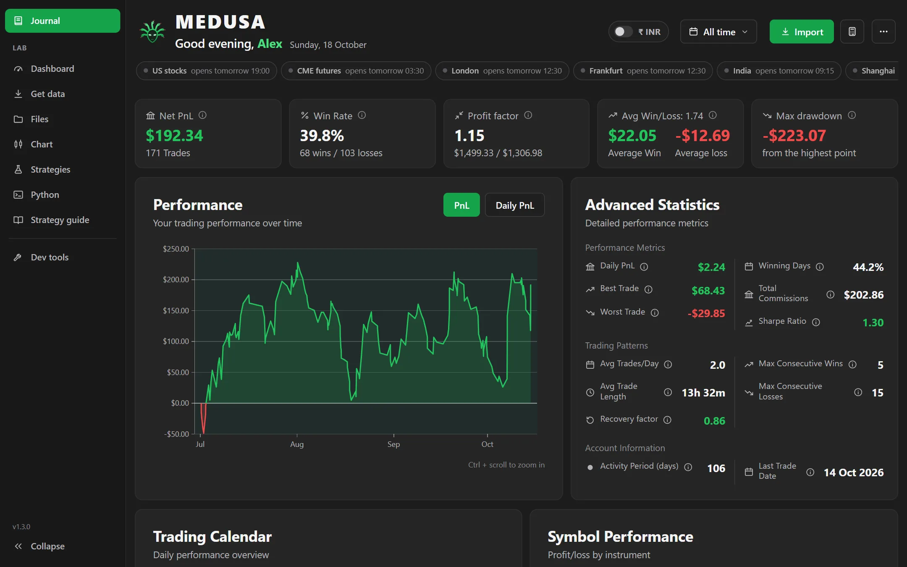
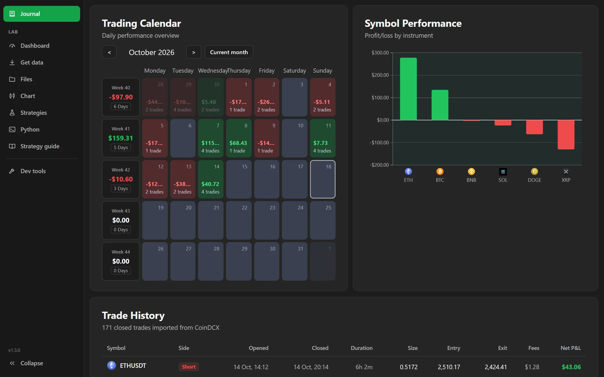
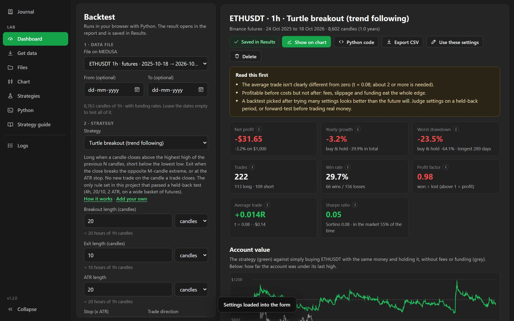
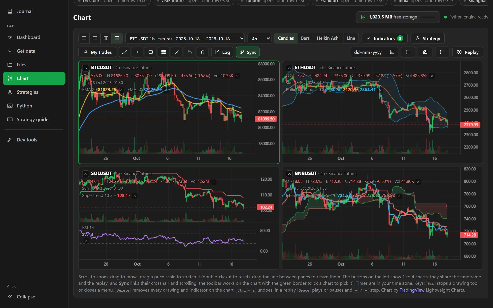
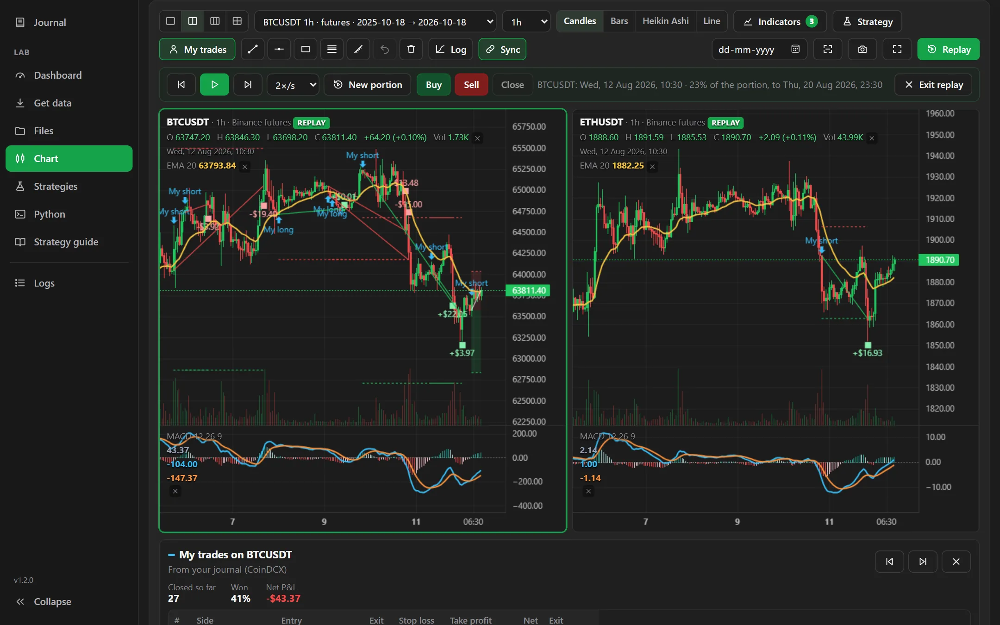
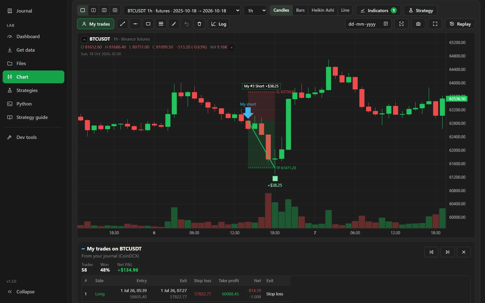
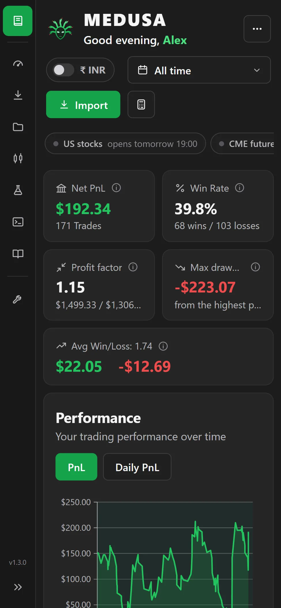
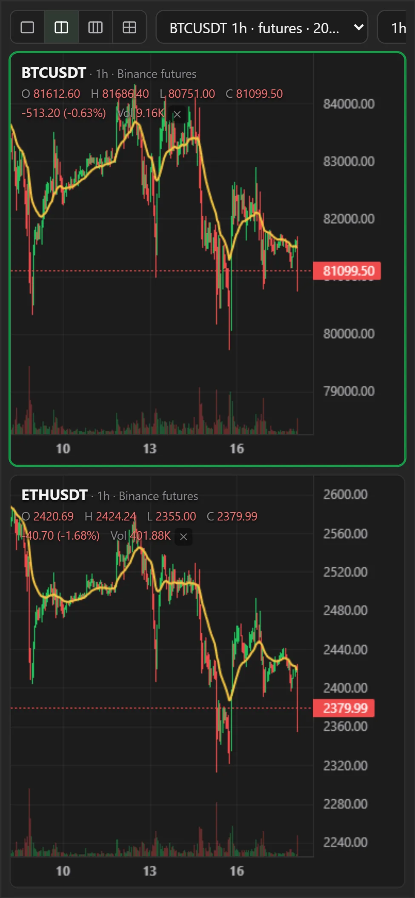
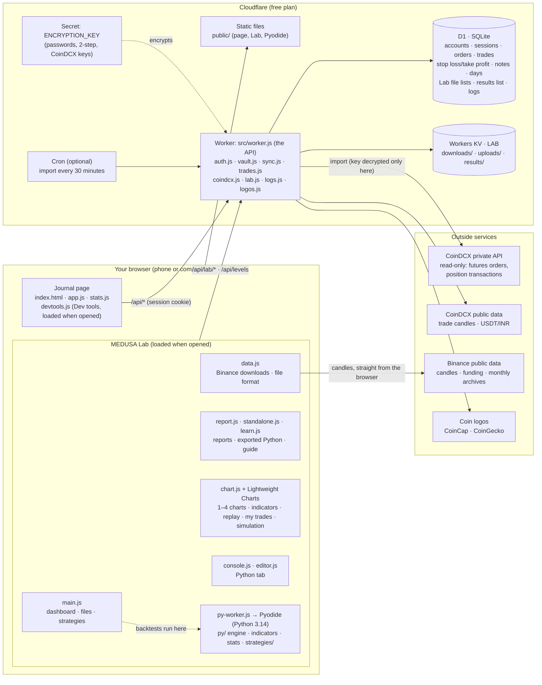

<p align="center">
  
</p>
<h1 align="center">MEDUSA</h1>
<p align="center">A trading journal and backtesting lab that runs free on Cloudflare.<br>
Version in <a href="public/version.json"><code>public/version.json</code></a> · every release in <a href="CHANGELOG.md">CHANGELOG.md</a></p>

<p align="center"></p>

## Screenshots

The screenshots use a demo account with made-up trades placed on real Binance prices.

| | |
|---|---|
|  |  |
| **Journal:** trading calendar, P&L by coin and every trade | **Lab:** a backtest report, with warnings first |
|  |  |
| **Chart:** four coins side by side, one timeframe | **Replay:** a picked portion, candle by candle, on every chart |
|  |   |
| **My trades:** your trades on the chart, with stop loss and take profit | **Phone:** the journal, and two charts in full screen |

## How it fits together



**In short:** the page and the Lab are static files. Everything that needs your account goes through the Worker, which only ever reads your own rows in D1 and your own Lab files in KV. Your CoinDCX key is stored encrypted and only the Worker can decrypt it, and Medusa only reads your trade history with it. Backtests and charts run in your browser (Python with Pyodide), because the free plan gives the server only a few milliseconds per request. Candles come straight from Binance to your browser.

## What it does

A one-page trading journal that imports your closed CoinDCX futures trades: net P&L (and the same trades before fees and funding), win rate, profit factor, average win and loss, max drawdown, performance chart, advanced statistics, trading calendar, P&L by coin (with logos) and your trade history, with notes for each trade. Works on phone, tablet and computer.

- **Date range:** pick a quick range or any From/To dates and every number, chart and the history show just that range. The trading calendar shows with **All time**; click a day on it to narrow the charts and history to that day, and click it again to go back.
- **Charts you can move:** drag or swipe the performance and coin charts sideways, pinch or Ctrl + scroll to zoom the performance chart, and double-click or double-tap to reset.
- **Each trade's chart** shows entry, exit, and the stop loss and take profit you set on CoinDCX.
- **Leverage calculator** (the calculator button, or **Leverage what-if** on a trade): what the same move would make at another leverage.
- **(i)** next to each number says what it means. The greeting uses the name you gave when signing up (change it in **⋯ → Your name**).
- **Accounts:** anyone with the link can create their own private account (name, email and password), then connects their own CoinDCX key. Each account only ever sees its own trades, notes and CoinDCX key. Optional two-step login with an authenticator app, and a recovery code for a forgotten password.
- **Markets** (in the menu): a live scanner of every Binance USDⓈ-M perpetual quoted in USDT: crypto coins and tokens, and the TradFi perpetuals on stocks, commodities, a currency and indices, each labelled with its type (filter by All, Crypto, Stocks, Commodities or Other). Each market's move today is compared with its own normal from the market data lakehouse (`lakehouse/`): how many of its usual daily moves (σ) it has moved (z). **Today** lists the markets that have moved at least 3 of them, with what similar moves did over the next 1, 4 and 24 hours since 2020, checked on years held back from the choice and after costs (tap one for the details in words), plus the market's breadth, the day's movers, and every market with search and sorting. **Patterns** shows every kind of move and its verdict. **Insights** draws graphs that look for an edge in every unusual move since 2020: year by year, the spread of outcomes, by the hour of the move, by size and liquidity, the whole market by hour of the day (2020–2024 against 2025 on), every kind of move at a glance, and every market right now (today's move against its volume, live); choose up or down moves and the next 1, 4 or 24 hours, and click a bar, cell or point to open the moves behind it in a window of its own. Every number and graph is **calculated by SQL** in a small SQLite database inside your browser, which holds MEDUSA's copies of the lakehouse tables and the live prices. The queries themselves are kept, with every version, in the lakehouse (`market.semantic.metric_definitions`) and arrive with the daily data; each number can show **how**: the query exactly as it ran and which version of its definition, its parameters and result, where each table comes from, a copy that runs in MEDUSA's D1 or in Databricks and returns the same result, and CSVs of the result and its inputs. In that window the SQL can be **edited**, previewed on your screen, and **saved** back to the lakehouse as a new version (the owner's account changes it for everyone; any other account keeps its own), with every earlier version a click away. Live prices come straight from Binance to your browser while the page is open; the daily numbers come from MEDUSA. Like every page, it needs a signed-in account.
- **Menu on the left:** Journal, Markets, the Lab's pages and Dev tools, as small icons with their names; **Collapse**, at the top, shrinks it to icons only (hover an icon for its name) and is remembered on the device. On a phone it is a slim bar of icons; the same button at the top slides the full menu over the page.
- **About MEDUSA** (in the **⋯** menu, or tap the version under the menu): the version, when it was released, what's new, and how your data is protected.
- **Market hours:** a strip under the header shows the markets that move crypto most (US stocks, CME Bitcoin futures, London, Frankfurt, India, Shanghai, Hong Kong, Seoul, Tokyo): open now, or when they open next, in your time (regular hours; holidays aren't included). Hover one for its hours.
- **Your time zone everywhere:** dates and times in the journal, the Lab, the reports, the Logs and the guide are in your device's time zone.
- **₹ INR** (top right): shows every USDT amount and price in rupees, at CoinDCX's live USDT/INR price (fetched by the Worker and cached for 5 minutes; shown next to the switch). Percentages and R multiples don't change. Works in the journal and the Lab; backtests still run in USDT.
- **Dev tools** (in the menu): the app's version and the newest on the server (a newer one is also noticed while MEDUSA is open, with a bar to reload), speed (the server's round trip and data centre, load times, memory, your connection, a live speed meter), speed-ups (get the Lab ready in the background, download the Python engine or libraries ahead of time), what this device stores for MEDUSA, clean-up (clear the cache, clear temporary data, reset settings, delete chart drawings, clear everything on this device; you stay signed in and your account isn't touched) and a diagnostic report without personal data.
- **Logs** (a tab in Dev tools): a short line for every action (imports, downloads, backtests, saves, deletes, errors), one folder per day in your time zone, kept on MEDUSA's server for your account only (up to 20,000 lines, the oldest go first). **Detailed logging** adds page changes and every request for debugging. Download a day as a text file, delete a day or all logs. Keys, passwords and codes are never written.
- **Nothing is saved twice:** repeating an action (the same download, upload, backtest result or strategy file, or a retried log line) finds what is already there instead of making a copy.
- **MEDUSA Lab** (in the menu): download any coin's history from Binance (into MEDUSA or to your computer), backtest strategies written in Python with a full report, keep every result (exportable as CSV), add your own strategies, and read a Strategy guide that explains every strategy with charts of real trades. See [MEDUSA Lab](#medusa-lab) below.

It runs free on Cloudflare (no credit card needed) and keeps its data in a small SQLite database there, plus Cloudflare's free key-value storage for the Lab's candle files.

## Put it online (free, no credit card)

You need Node.js (https://nodejs.org) and about 15 minutes.

**1. Create a free Cloudflare account** at https://dash.cloudflare.com/sign-up (email and password, then confirm your email).

**2. Open PowerShell in this folder.** In File Explorer, open the `medusa` folder, click the address bar, type `powershell` and press Enter.

**3. Sign in to Cloudflare from PowerShell.** A browser window opens; click Allow. If PowerShell asks `Ok to proceed?`, type `y`.
```
npx wrangler@4 login
```

**4. Create the database.** It prints a `database_id`. Copy `wrangler.example.toml` to a new file named `wrangler.toml` (it stays on your computer: `.gitignore` keeps it out of git), open it in Notepad, replace the zeros after `database_id =` with the id, and save.
```
npx wrangler@4 d1 create medusa
```

**5. Create the Lab's storage.** It prints an `id`. In `wrangler.toml`, replace the zeros after `id =` (under `[[kv_namespaces]]`) with it, and save.
```
npx wrangler@4 kv namespace create LAB
```

**6. Create the tables.** Type `y` if asked.
```
npx wrangler@4 d1 execute medusa --remote --file=schema.sql
```

**7. Publish.** The first time, it asks you to choose a `workers.dev` name (for example your name). It prints your link, like `https://medusa.yourname.workers.dev`.
```
npx wrangler@4 deploy
```

**8. Create the encryption key.** It protects passwords, two-step secrets and CoinDCX keys. It is random and never shown. Accounts can't be created until it is set.
```
node -e "process.stdout.write(require('crypto').randomBytes(32).toString('base64'))" | npx wrangler@4 secret put ENCRYPTION_KEY
```

**9. Create your account.** Open your link and press **Create an account**. It takes three steps:
   1. Your name (for the greeting), email and a password (at least 12 characters).
   2. Save the recovery code it shows.
   3. Paste your CoinDCX API key and secret (see below), then press **Import my trades**. You can also skip this and connect later from the **⋯** menu.

**10. On your phone,** open the link, sign in, then use the browser menu's **Add to Home screen**. You stay signed in on each device for as long as you use it at least once every 60 days.

To publish changes later, run `npx wrangler@4 deploy` again.

**Market data from the lakehouse (optional).** The live scanner reads a daily copy of the market data
lakehouse's tables (`lakehouse/README.md`). The tables are in `schema.sql`; an older install creates
them with `npx wrangler@4 d1 execute medusa --remote --file=migrations/003_market.sql` and
`npx wrangler@4 d1 execute medusa --remote --file=migrations/004_metrics.sql` (the metric definitions). The copy
arrives through `POST /api/market/ingest`, which only accepts requests carrying the
`MARKET_INGEST_TOKEN` secret and can only replace those tables. Generate a token with
`node -e "console.log(require('crypto').randomBytes(32).toString('base64url'))"`, save it with
`npx wrangler@4 secret put MARKET_INGEST_TOKEN`, and save the same value as the GitHub Actions secret
`MEDUSA_INGEST_TOKEN` (with the app's address as `MEDUSA_URL`). Without the secret, the endpoint
answers 503 and nothing else changes. The scanner page reads the copy back through
`GET /api/market/scanner`, which, like the rest of MEDUSA, needs a signed-in account. Its answer is
the same for every account, so the ingest saves it ready-made in Workers KV after every publish (key
`market/scanner.json` in the Lab's namespace, 2 writes a day) and page loads read that instead of D1;
each browser keeps it for 5 minutes.

**MEDUSA's failures in the lakehouse (optional).** The lakehouse's daily run copies the error lines MEDUSA's
pages reported (the Markets page among them) and the errors its server hit into `ops.logs.app_events`
(`lakehouse/docs/steps/31-ops-log-tables.md`), through `GET /api/ops/events`, which only answers requests
carrying the `OPS_EXPORT_TOKEN` secret and never sends which account. Make a token without showing it
(`lakehouse/docs/operations.md`, *Secrets*), save it in Cloudflare (`npx wrangler@4 secret bulk <file>` or
`secret put OPS_EXPORT_TOKEN`) and as the GitHub Actions secret `MEDUSA_OPS_TOKEN`. Without it the endpoint
answers 503 and the copy is skipped.

**Saving the Markets definitions (optional).** Each calculation window can save an edited query to the
lakehouse: the owner's account as the shared version, every other account as its own version
(`market.semantic.metric_definitions` and `market.semantic.user_metric_definitions` in Databricks).
MEDUSA's server signs in to Databricks as a service principal that may only use the SQL warehouse and
read and change those two tables (OAuth client credentials with the `sql` scope; `lakehouse/docs/operations.md`
has the setup). Create the copy's table with
`npx wrangler@4 d1 execute medusa --remote --file=migrations/005_user_metrics.sql`, then save four secrets
with `npx wrangler@4 secret put`: `DATABRICKS_HOST` (the workspace address), `DATABRICKS_CLIENT_ID` and
`DATABRICKS_CLIENT_SECRET` (the service principal's), and `MARKET_OWNER_ID` (the number of the account
whose saves are shared: `SELECT id FROM users WHERE username = 'your email'`). `DATABRICKS_WAREHOUSE_ID` is
optional; without it the warehouse is found by its name. Without the first three, saving is off and the
windows only preview. Each account can save 20 times a day, and MEDUSA 300 times in all, because every
save wakes the warehouse. The same login reads each definition's **History** (60 times a day per account,
600 in all), and the owner's account can **Reload** the definitions from Databricks after a change made
there by hand.

**Release version:** it is kept in one place, `public/version.json` (the number, the date and what changed), and shown at the bottom of the menu on the left and on the sign-in page. When you publish a new release, raise the number there (for example 1.2.0 → 1.3.0) and add a section with the same number to `CHANGELOG.md`, which keeps every version and what changed in it.

## Your CoinDCX key and how it's protected

On coindcx.com, open **API dashboard, then Create API key**. Make a new key only for Medusa and leave **Bind IP address** unticked: Cloudflare doesn't use one fixed IP, so a bound key would stop working.

- **Checked first:** Medusa tests the key with CoinDCX before saving anything.
- **Encrypted:** it is stored with AES-256-GCM. The encryption key (step 8) sits in Cloudflare's secret store, which can't be read back, not in the database.
- **Never shown again:** the key and secret are never sent back to your browser. The app only shows the last 4 characters of the key.
- **Read-only in practice:** CoinDCX keys can't be made read-only, so Medusa enforces it itself. It can only call two history endpoints (`futures/orders` and `futures/positions/transactions`), and it has no code that places, changes or cancels orders or moves money.
- **Password protected:** connecting or replacing the key asks for your account password again, except in the first 30 minutes after signing in (so a new account can connect its key right away). Wrong passwords are rate-limited (8 tries per 15 minutes).
- **One key per account:** each account's key is encrypted together with its account number, so it can't be copied into another account.
- **No logs:** request logging is off, so the key never lands in a log.

What you should do:

- Turn on two-factor login for both Cloudflare and CoinDCX. The one thing encryption can't stop is someone who takes over your Cloudflare account and changes the app.
- Use a long Medusa password, turn on two-step login (**⋯ → Account & security**), and sign out (**⋯ → Sign out**) on any device that isn't yours.
- If you ever think the key leaked, delete it on CoinDCX. It stops working immediately. Then create a new one and press **Connect CoinDCX** again.

## Accounts and security

Anyone with the link can create an account with their name, email and a password. Emails are only the sign-in name: free Cloudflare accounts can't send email, so addresses are never verified or written to. Everything else is in **⋯ → Account & security**: change password, two-step login, a new recovery code, signed-in devices, and deleting the account.

- **Passwords** are stored only as a salted PBKDF2 hash (25,000 rounds, what fits in the free plan's CPU limit) of an HMAC keyed from `ENCRYPTION_KEY`. A copy of the database alone can't reveal a password or be used to test guesses.
- **Sessions** are random 256-bit tokens in an HttpOnly, Secure, SameSite=Strict cookie; the database keeps only their SHA-256. A device stays signed in while it is used at least once every 60 days. Changing the password signs out every other device; **Sign out the others** does it on demand.
- **Two-step login** (optional, per account): 6-digit codes from any authenticator app (Google Authenticator, Microsoft Authenticator, Authy, 2FAS). The secret is stored encrypted and each code works only once.
- **Recovery code**: shown once when the account is made. With the email it resets the password and turns two-step login off, for a forgotten password or a lost phone. Using it signs out every device and gives a new code. Free Cloudflare accounts can't send email, so there is no email reset; the recovery code is the only way back in.
- **Rate limits**: 10 wrong passwords per address and per account in 15 minutes, 6 wrong two-step codes per account in 15 minutes, 6 wrong recovery codes per hour, 5 new accounts per address per hour and 100 in total per day.
- **Deleting an account** removes its trades, notes, day journals, settings, CoinDCX key, sessions and all its Lab files (Downloads, Uploads, Results) and strategy files for good.
- Changing `ENCRYPTION_KEY` would lock every account (passwords, two-step secrets and CoinDCX keys all depend on it). Don't change it once people use the app.

## Upgrading from the single-password version

Older versions had one password (`APP_PASSWORD`) and no accounts. To upgrade a database that already has your trades:

1. Back up: `npx wrangler@4 d1 export medusa --remote --output=backups/before-accounts.sql`
2. Upgrade the tables (keeps everything, owned by nobody for now): `npx wrangler@4 d1 execute medusa --remote --file=migrations/001_accounts.sql`
3. Deploy: `npx wrangler@4 deploy`
4. Open the app and create your account.
5. Optional, to keep the old journal instead of re-importing from CoinDCX: in `migrations/claim.sql`, replace `YOUR_USERNAME` with your account's email, then `npx wrangler@4 d1 execute medusa --remote --file=migrations/claim.sql`
6. Remove the old password: `npx wrangler@4 secret delete APP_PASSWORD`

## MEDUSA Lab

The Lab's pages are in the menu on the left:

- **Dashboard:** pick a data file (from the Downloads or Uploads folder) and a strategy, adjust its settings, costs (fee, slippage, funding), money (starting amount, risk per trade, leverage) and an optional held-back date, then **Run backtest**. Every result is saved automatically in the **Results** folder; the Dashboard lists them and shows the selected one (the newest when you open the Lab). The report shows warnings first, then net profit, yearly growth, worst drawdown, win rate, profit factor, average trade in R and Sharpe; account value against buy and hold; a zoomable price chart with every trade; before and after costs; the held-back check; by year, long and short, how trades ended; monthly returns; the spread of results; and every trade. **Export CSV** downloads all of it as one CSV file (a section per part of the report, for Excel or Google Sheets); **Use these settings** puts a result's settings back in the form; **Delete** removes it. **Python code** shows the complete standalone Python program behind a result (MEDUSA's engine files, the strategy, the exact settings and a runner that downloads the same Binance data), with Copy and Download: `python medusa_<strategy>_<coin>_<timeframe>.py` on any computer with numpy repeats the test and checks it gets the same numbers (`--csv` for an uploaded file, `--trades` and `--json` to save the results).
- **Indicator lengths with units:** every length setting can be typed in candles, minutes, hours, days or weeks (a 35-day EMA on 1-hour candles is 840 candles), with suggestions that suit the timeframe. The form shows the **warm-up** these settings need (below).
- **Get data:** download any Binance coin (popular ones are one click; futures or spot; any timeframe from 1 minute to 1 week; the last 1, 2, 3 or 5 years, all time, or custom dates; with funding rates for futures) in one of two ways:
  1. **Download to MEDUSA:** saved in the **Downloads** folder, ready to backtest (up to 1,000,000 candles).
  2. **Download to this computer:** a ZIP (smaller, includes funding rates) or CSV file (up to 2,000,000 candles). Upload it later with **Upload a file and backtest it**: the form asks what the data is (coin, futures or spot, timeframe, all detected from the file), which dates, which strategy and its settings, then saves the file in the **Uploads** folder, runs the test and shows the result on the Dashboard. Tick **Delete the file from MEDUSA after the backtest** to keep only the result. It also reads Binance's monthly archive .zip files and other candle CSVs (TradingView exports, for example).
- **Files:** the **Downloads**, **Uploads** and **Results** folders on MEDUSA's server, with each file's size, **Delete** for one file or **Delete all** for a folder, and a download button to copy a data file back to your computer. Next to the Downloads folder (and in the Lab's top bar on every tab) is how much of Cloudflare's free 1 GB of storage is still unused.
- **Chart:** a TradingView-style chart of any data file, with timeframes, indicators, drawing tools (among them **Long** and **Short positions**: click the entry, the stop loss and the take profit, and the box shows what the candles after it did), backtests drawn on the candles, and a candle-by-candle **replay**: press **Replay**, click the first and the last candle of the portion to replay (or pick From/To dates), then play, step and trade. **Simulate** opens a trading simulation: one account, with an optional starting amount, leverage, a size per trade, fees and slippage, trades your positions and, in a replay, the market, limit and stop orders you place (with a take profit, stop loss and trailing stop); every trigger is listed, and the closed trades download as a CSV file. Show **1, 2, 3 or 4 charts** side by side (buttons at the left of the toolbar): they always share one timeframe and one replay, so different coins stay in step, and **Sync** links their crosshair and scrolling. The toolbar works on the chart with the green border. The **×** next to an indicator on the chart removes it; the **Delete** key (or the trash button) removes every drawing and indicator on the chart, and **Ctrl+Z** brings them back. **Full screen** works on phones too (on an iPhone, which has no full screen for web pages, the charts fill the window); turn the phone sideways to see two charts side by side. **My trades** draws your journal trades on the chart's coin, the way backtest trades are drawn, with the stop loss and take profit you set on CoinDCX (red and green lines, and their R) (with a list under the chart, and in a replay they appear as their time comes); **Show on chart** in a trade's window opens it on a downloaded file of that coin. CoinDCX's `B-BTC_USDT` is matched to Binance's `BTCUSDT`, and prices are checked against the candles (a coin quoted per 1,000 units on one exchange is scaled to match).
- **Strategies:** 24 built-in strategies in three groups, each labelled with how its published settings did in our test (7 coins, 2019-2026, after costs): **Classic indicators** (EMA crossover, Turtle breakout, RSI reversal, MACD crossover, Bollinger reversion, buy and hold), **Intraday and scalping** (VWAP trend, VWAP band reversion, opening range breakout, noise-area breakout, first half-hour momentum, Bitcoin 21-23 UTC hours, fade the last candle, Supertrend, MACD + 200 EMA, price vs moving average) and **Short-term swing** (Larry Williams volatility breakout, Connors RSI(2), TTM Squeeze, Turtle Soup, Quantpedia's Bitcoin 10-day high/low, follow an abnormal day, fade extreme funding, Ichimoku). And your own Python files: **Write a new strategy** (a commented template), **Upload a .py file**, **Copy** a built-in one to change it, **Edit**, **Check** (runs it on test candles and fails it if it looks into the future), **Save** (kept on MEDUSA's server with your account), **Download**, **Delete**.
- **Python:** a small editor that runs any Python on your data files: tick files from the Downloads/Uploads folders (or add a CSV/ZIP from this computer), then `load()` them, call `backtest("ichimoku", data, ...)` with any built-in strategy or a `Strategy` class written in the same code (the Dashboard's engine, same numbers), print, and chart with matplotlib. numpy, pandas, matplotlib, scipy and statsmodels are available; each is downloaded only the first time your code imports it. A result's `.save()` puts it in the Results folder. Ctrl+Enter runs, Stop ends a run. The code is kept in the browser; Save as .py / Open move it to and from files.
- **Strategy guide:** what backtesting is, how the Lab works, reading the report, getting data, writing your own strategy, the Python tab, a glossary, a page for each built-in strategy (its source and published claim, the exact rules, charts of a real winning and losing trade worked through step by step, and our test results), and a page for each of your own strategies (from the description at the top of its file).

**How it works, and why it costs nothing:** Cloudflare's free plan allows only a few milliseconds of computing per request, far too little for a backtest, so backtests run **in your browser**: Python 3.14 with numpy (Pyodide, served from `public/lab/pyodide/`, about 16 MB, downloaded once and then kept by the browser) runs the engine in a background thread. The Python tab's extra libraries (pandas, matplotlib, scipy, statsmodels and their helpers, 37 MB in all, checked against Pyodide's published checksums) sit in the same folder and are only downloaded when code imports them. **Warm-up:** each length setting says what it feeds (`Param(..., unit="candles", warmup=EMA)`): a plain window needs 1x its length, an EMA 4x, Wilder's smoothing (RSI, ATR, ADX) 8x, and the strategy needs the largest plus one candle (a strategy can override `warmup()`). Those candles come from before the start date (or the start of the file) and only feed the indicators; trading and the report start after them, so the same settings always give the same test. The browser downloads Binance candles directly (Binance allows it), so the server is never involved in downloads. Files kept on MEDUSA are compressed in the browser first (prices kept exactly, about 8-15 bytes per candle) and stored in **Workers KV** (binding `LAB`) under `downloads/`, `uploads/` and `results/`; their lists and your strategy files are in D1. Strategy code runs only in the browser of the account that owns it, with network access switched off inside the Python thread.

**Changing a built-in strategy:** edit its file in `public/lab/strategies/` (for example `turtle.py`), then `npx wrangler@4 deploy`. To add one: put the `.py` file in that folder, add its file name to `public/lab/strategies/index.json`, optionally write `public/lab/docs/<key>.html` and add it to the `BUILTIN` list (and `VERDICT`, if tested) in `public/lab/learn.js`, and deploy. Your own strategies (Lab, then Strategies) need no deploy. The engine itself is in `public/lab/py/` (`engine.py` fills and costs, `indicators.py` with about 60 indicators, `strategy.py`, `stats.py`, `backtest.py` (warm-up, dates and both runs, shared by the Dashboard, the Python tab and exported code), `labrun.py`, the bridge to the page, and `export_runner.py`, the runner in exported code). It is the same engine as the old local Lab, which reproduced the earlier research trade for trade. In October 2026 every built-in strategy was also checked against an independently written second backtester (90 runs, about 127,000 trades, all identical), and the browser (Pyodide) against desktop Python on the same Binance data (45 runs, identical); exported code reproduced its results to the cent (24 of 24). `py/console.py` is the Python tab's side of the engine.

**Adding the Lab to an install made before it existed:** run `npx wrangler@4 kv namespace create LAB`, paste the printed id into `wrangler.toml` (under `[[kv_namespaces]]`), then `npx wrangler@4 deploy`. The Worker creates the Lab's three tables the first time the Lab is used (or run `migrations/002_lab.sql` yourself).

## Importing

- Trades are imported only when you press **Import** (or **Import my trades** when setting up). Opening the app never imports by itself.
- Only closed trades appear. An open position shows up once you close it.
- Each import fetches only what isn't saved yet and never duplicates anything. It also reads your stop-loss and take-profit orders (placed, cancelled or filled) so each trade's chart can show them. The first import after this was added reads your whole order history once; later imports only look at recent orders. If CoinDCX refuses that part, the rest of the import still works.
- If something looks wrong, **⋯ → Re-import everything** fetches your history again. Your notes are kept.

## Free plan limits

Cloudflare's free plan allows 100,000 requests a day, and the database holds 5 GB with 5 million reads a day. These limits are shared by every account. A personal journal uses a tiny fraction of them; a few dozen active users still fit. If a limit is ever reached, the app pauses until the next day; the free plan never charges you.

The Lab's folders use Workers KV: 1 GB in total, 100,000 reads and 1,000 writes a day (each file saved on MEDUSA, a download or a result, is one write). The Markets page's ready-made answer uses one more key: two writes a day, and one read per page load; the Insights file another (about 0.6 MB): one write a day, and one read when a browser opens Insights without a copy of that day's file. Each account may store up to 300 MB, and all accounts together 950 MB (`LAB_QUOTA_MB` and `LAB_TOTAL_MB` in `wrangler.toml`). Static files (the page, the Lab and Pyodide) don't count towards any limit.

## Files

- `public/`: the page (`index.html`, `app.css` (every page's styles, shared with the calculation windows), `app.js` (the journal, the menu, market hours, the INR switch and the Logs), `devtools.js` (the Dev tools page, loaded when it is opened), `markets.js` (the Markets page, the live scanner, loaded when it is opened: Today, Patterns and Insights; it feeds the SQL engine and draws what the queries return), `markets-charts.js` (the Insights graphs: a query's result drawn as SVG from the chart spec in its definition), `markets-window.html` and `markets-window.js` (one number's calculation in its own window, opened by its ‹› button: the same code with its own data, engine and live prices, running only that number's queries, with an editor to change its SQL, preview the result on that screen, save it to the lakehouse and see every earlier version), `markets-metrics.js` (the built-in copy of every number on Markets as SQL, used until the lakehouse's definitions are published: shared steps and a query per card or table; its rule matches `lakehouse/dbt/models/gold/intraday_events.sql`), `markets-sql.js` (the SQL engine: SQLite in a background worker; it unpacks the Insights file into its tables), `stats.js`, `version.json` (the release), icons)
- `public/vendor/sqljs-1.14.2/`: sql.js, SQLite compiled to WebAssembly (MIT licence, `LICENSE` included), used by `markets-sql.js`
- `public/lab/`: MEDUSA Lab, loaded only when the Lab is opened: `main.js` (the tabs: dashboard, get data, files, strategies), `console.js` (the Python tab, loaded when opened), `chart.js` (the Chart tab, loaded when opened; `sim.js` is its trading simulation and `vendor/` holds its chart library), `data.js` (Binance downloads, files for your computer, reading uploads, the compressed file format), `report.js` (the report and its CSV export), `standalone.js` (a result's standalone Python code), `learn.js` (the Strategy guide), `util.js`, `lab.css`, `py-worker.js` (the Python engine thread), `py/` (the Python engine), `strategies/` (built-in strategies and `index.json`), `template.py` (the new-strategy template), `docs/` (Strategy guide pages, and `examples/` with the real trades their charts show), `pyodide/` (Python for the browser)
- `src/lab.js`: the Lab's API: the Downloads, Uploads and Results folders (KV, listed in D1), free storage, and your strategy files
- `src/worker.js`: the API; every query is limited to the signed-in account. Also `/api/fx` (CoinDCX's USDT/INR price), `/api/ping` and `/api/clear-site-data` (for Dev tools)
- `src/logs.js`: the Logs (table `app_logs`, created the first time it's used)
- `src/auth.js`: accounts, sessions, two-step login, recovery codes, rate limits
- `src/http.js`: small shared response helpers, and the error pages a person sees on opening an address that needs a sign-in, doesn't exist or fails (the app's own calls get JSON errors)
- `src/vault.js`: encrypts and decrypts each account's CoinDCX key
- `src/coindcx.js`: the read-only CoinDCX client
- `src/sync.js`: the import (small steps, only new data)
- `src/trades.js`: turns orders into closed trades, and finds each trade's stop loss and take profit
- `src/logos.js`: coin logos
- `src/market.js`: the market copy for the live scanner: `POST /api/market/ingest`, write-only, with its own token, which also saves the scanner's answer ready-made in KV; `GET /api/market/scanner`, read-only, for signed-in accounts; `PUT /api/market/insights` (the same token) and `GET /api/market/insights` (signed in): the Insights history, one gzip file kept in KV as the lakehouse sent it
- `src/ops.js`: MEDUSA's own failures for the lakehouse's operations logs: errors the server hits (`server_events`, no account), and `GET /api/ops/events`, read-only with its own token, which the lakehouse's daily run reads (the pages' error lines and the server events, emails replaced)
- `src/metrics.js`: saving the Markets definitions to the lakehouse: `GET /api/market/metrics/mine` (the account's own versions), `POST /api/market/metrics/save`, `POST /api/market/metrics/reset`, `GET /api/market/metrics/history` and `POST /api/market/metrics/reload` (the owner only); signs in to Databricks as a service principal and runs parameterized statements through the SQL Statement API
- `schema.sql`: the database tables (for a new install)
- `migrations/`: upgrading a single-password database to accounts (`001_accounts.sql`, then `claim.sql`); the Lab's tables (`002_lab.sql`, optional); the market copy for the live scanner (`003_market.sql`), its metric definitions (`004_metrics.sql`), each account's own versions of them (`005_user_metrics.sql`) and the days the lakehouse is missing (`006_missing_days.sql`)
- `wrangler.example.toml`: the Cloudflare settings, without anyone's ids; copy it to `wrangler.toml` (step 4)
- `CHANGELOG.md`: every release and what changed in it (the current version is in `public/version.json`)
- `docs/images/`: the screenshots in this README
- `THIRD_PARTY_NOTICES.md`: the open-source software bundled with MEDUSA and its licences

## Licence

MEDUSA is free for personal, non-commercial use under the
[PolyForm Noncommercial License 1.0.0](LICENSE) (SPDX: `PolyForm-Noncommercial-1.0.0`).
Selling it, offering it as a paid service, or using it in a business needs
my permission: contact me through GitHub.

Third-party code bundled with MEDUSA keeps its own licence; see
[THIRD_PARTY_NOTICES.md](THIRD_PARTY_NOTICES.md).
