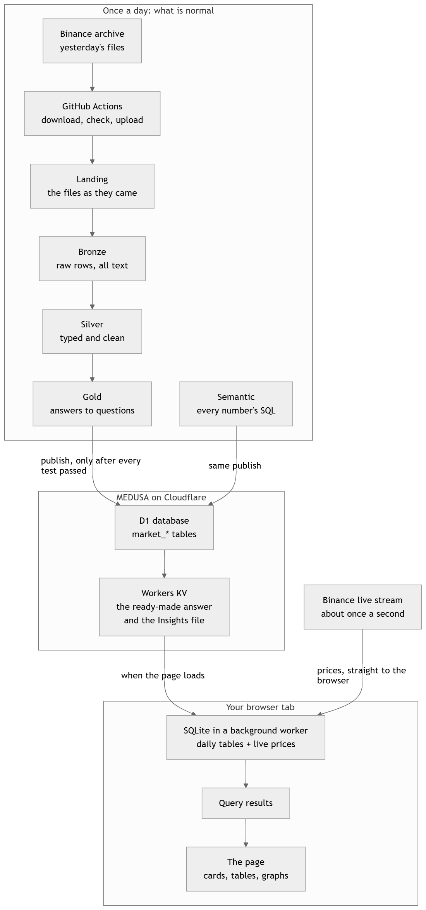
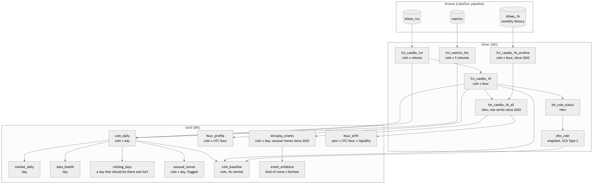
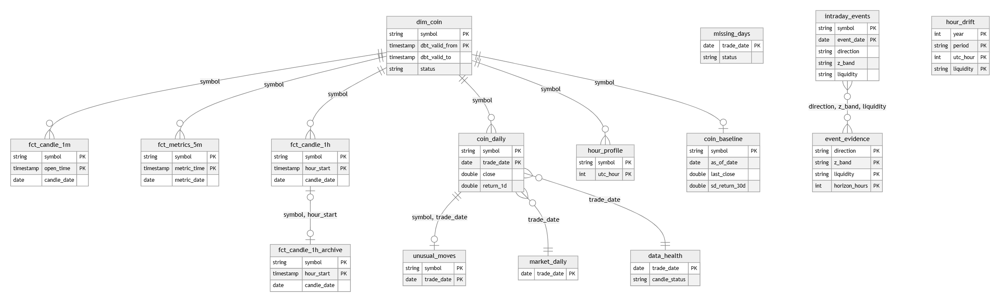
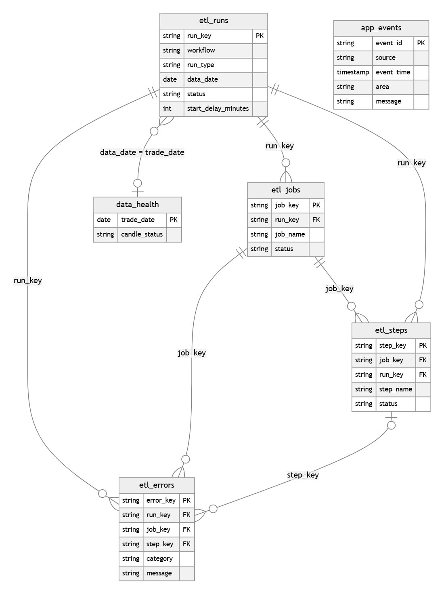
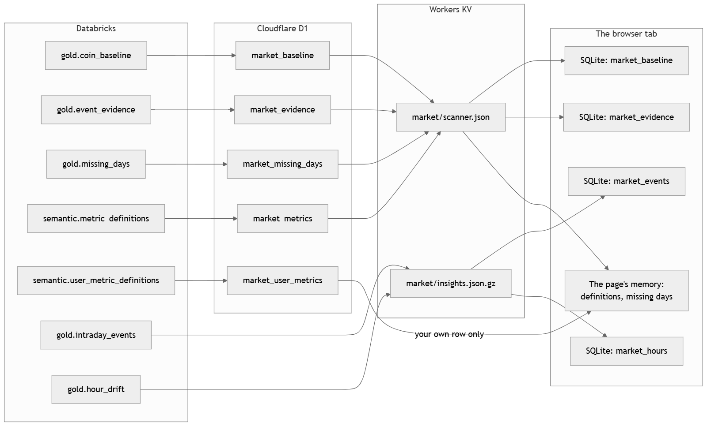
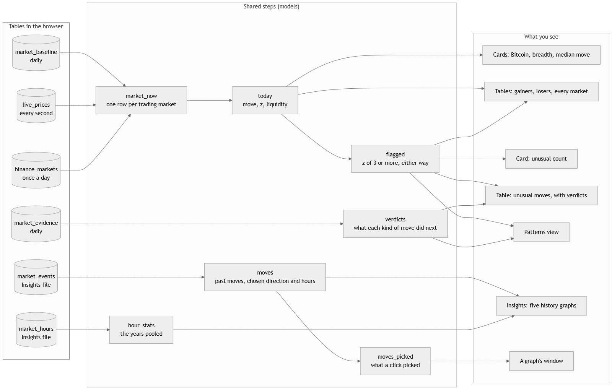
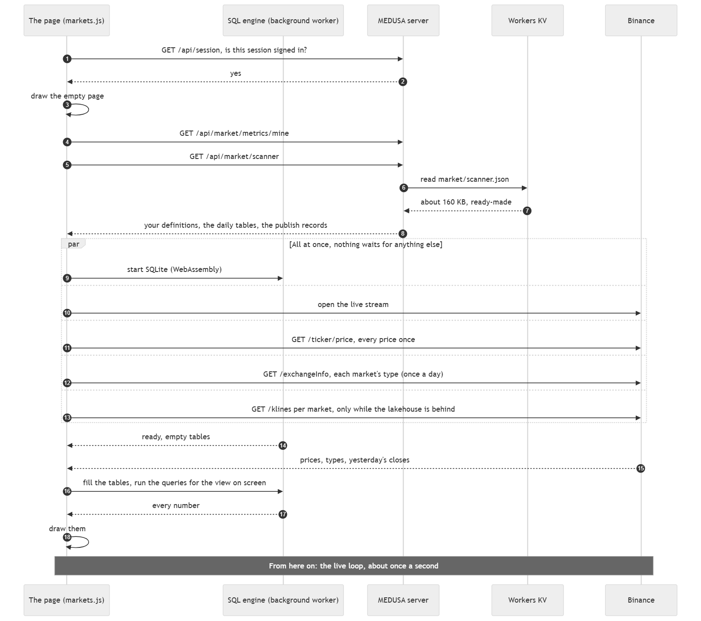
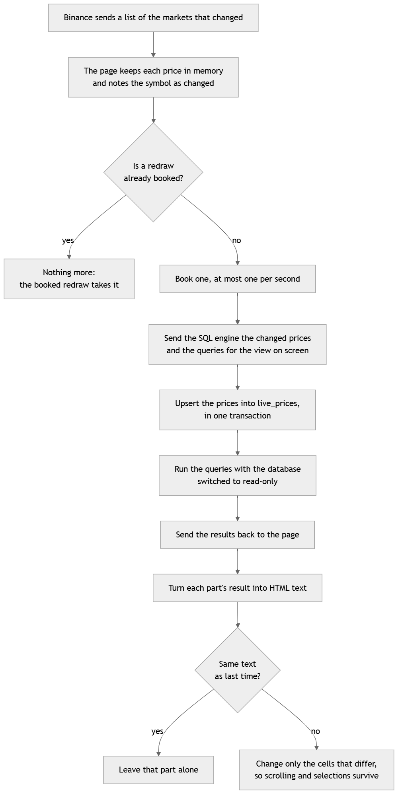

# How MEDUSA's data works

From a file on Binance's archive to a number on the Markets page, and back again when a number looks
wrong. Every table, every hop, and one number followed all the way with its real values.

Values in this guide were measured on 2026-10-31 unless it says otherwise. Row counts grow every day; the
shapes don't.

1. [The short version](#1-the-short-version)
2. [Where everything lives](#2-where-everything-lives)
3. [How the tables relate](#3-how-the-tables-relate)
4. [A day in the pipeline](#4-a-day-in-the-pipeline)
5. [What happens when you refresh the page](#5-what-happens-when-you-refresh-the-page)
6. [The one-second loop](#6-the-one-second-loop)
7. [One number, all the way: Bitcoin's z](#7-one-number-all-the-way-bitcoins-z)
8. [One graph, all the way: Year by year](#8-one-graph-all-the-way-year-by-year)
9. [A number looks wrong: walking back upstream](#9-a-number-looks-wrong-walking-back-upstream)
10. [Why it is built this way](#10-why-it-is-built-this-way)

---

## 1. The short version

A move of 3% means nothing by itself. It is a quiet day for one coin and a huge day for another. So the
Markets page answers one question: **is this market's move unusual for this market?** That takes two kinds
of data, which arrive at very different speeds.

| | What is normal | What is happening |
|---|---|---|
| The question | How much does this market usually move in a day? | What is its price now? |
| Comes from | The last 30 days, in the lakehouse | Binance's live stream |
| Changes | Once a day | About once a second |
| Path | Binance's files → Databricks → Cloudflare → the browser | Binance → the browser, directly |
| Kept | In Databricks for good, with a small copy on Cloudflare | Only in the open tab |

The two meet in your browser tab, in a small SQLite database. Neither Databricks nor MEDUSA's server ever
calculates today's numbers: the tab does, with SQL, about once a second.

The measure is **z**: how far today's move is from the market's average day, in units of its usual daily move
(written σ, the standard deviation of its daily returns). A z of 3 is a move three times the usual size, and
that is what the page calls unusual.

```text
move = live price / yesterday's close - 1
z    = (move - average daily move) / usual daily move
```



Three places, three jobs:

- **The lakehouse does the heavy work once a day.** It turns about 52 million rows of 1-minute candles into
  759 rows, one per market, each saying what is normal for that market.
- **Cloudflare keeps a small copy.** Opening a page never wakes the Databricks warehouse, which is what
  keeps a free plan free.
- **The browser does the last sum.** Everyone's sum is the same and the stream is public, so there is no
  need for a server to carry prices at all.

### If you know SQL Server

| Here | The nearest thing in SQL Server |
|---|---|
| Catalog, schema, table (`market.gold.coin_daily`) | Database, schema, table |
| Landing volume | The folder a `BULK INSERT` reads from |
| Bronze streaming table (Auto Loader) | A staging table, filled by a job that remembers which files it has read |
| Silver | Cleaned fact and dimension tables |
| Gold | Reporting tables or a data mart |
| dbt model | A `SELECT` kept in a file; dbt wraps it in `CREATE TABLE AS` or `MERGE` |
| dbt incremental model | A stored procedure doing a `MERGE` of the rows after a watermark |
| dbt test | A query that must return no rows, or the build fails |
| dbt snapshot (`dim_coin`) | A Type 2 slowly changing dimension; a temporal table is the closest built-in |
| D1 | A small database on Cloudflare (SQLite underneath) |
| Workers KV | A key-value cache: put one big value under one name, read it back fast |
| SQLite in the browser | A throwaway database that lives in the tab's memory and dies with it |
| The publish job | A nightly ETL that truncates and reloads a reporting copy, in one transaction per table |

---

## 2. Where everything lives

| Store | What it holds | Written by | Read by | Kept for |
|---|---|---|---|---|
| **Landing volume** `market.landing.binance` | Files as they came: one folder per dataset and day, plus each day's manifest | The GitHub workflows | Bronze | Planned: about 30 days |
| **Bronze** `market.bronze` | One row per file line, every column as text | Lakeflow pipeline (Auto Loader) | Silver | Planned: about 12 months for 1-minute rows |
| **Silver** `market.silver` | Typed, de-duplicated facts, and `dim_coin` | dbt | Gold | Planned: about 12 months for 1-minute rows; hours for good |
| **Gold** `market.gold` | Daily answers and each market's normal | dbt | The publish job, analysis in SQL | For good; most tables are rebuilt in every run |
| **Semantic** `market.semantic` | Every number's name, meaning and SQL, all versions | The seed jobs, and saves on the page | The publish job, MEDUSA's server | For good |
| **Ops** `ops.logs` | Every workflow run, job, step and error; MEDUSA's errors | The last job of each workflow | You, in SQL | For good, append-only |
| **D1** (Cloudflare) | The `market_*` copy, plus the journal, accounts and the Lab | The publish job, through a write-only endpoint | MEDUSA's server | Replaced at each publish |
| **Workers KV** (Cloudflare) | `market/scanner.json`, `market/insights.json.gz` | MEDUSA's server | Page loads | Replaced at each publish |
| **Browser SQLite** | The daily tables, live prices, the Insights tables | The page | The page's queries | Until the tab closes |
| **Browser local storage** | Today's market types, yesterday's closes, your filters | The page | The page | Until replaced |

The planned limits come from [ADR-011](../lakehouse/docs/decisions.md#adr-011-keep-1-minute-candles-for-a-limited-time).
No job removes anything yet: the data only starts in September 2026, and the oldest landing folder is still
there.

Nothing that is personal lives in the `market` tables, apart from each account's own versions of a
definition (`market.semantic.user_metric_definitions` and its copy, `market_user_metrics`). The Markets
page's answer is the same for every account, which is why it can be made once and kept ready.

### How much is in each place

| Table | Rows | | Table | Rows |
|---|---:|---|---|---:|
| `bronze.klines_1m` | 52,387,310 | | `gold.coin_daily` | 36,398 |
| `bronze.metrics` | 8,602,522 | | `gold.market_daily` | 42 |
| `bronze.klines_1h` | 15,907,630 | | `gold.data_health` | 42 |
| `silver.fct_candle_1m` | 52,387,310 | | `gold.missing_days` | 1 |
| `silver.fct_metrics_5m` | 8,602,522 | | `gold.unusual_moves` | 728 |
| `silver.fct_candle_1h` | 873,132 | | `gold.hour_profile` | 21,288 |
| `silver.fct_candle_1h_archive` | 15,887,385 | | `gold.hour_drift` | 672 |
| `silver.int_candle_1h_all` (view) | 16,494,486 | | `gold.coin_baseline` | 759 |
| `silver.dim_coin` | 1,896 | | `gold.intraday_events` | 21,373 |
| `semantic.metric_definitions` | 33 | | `gold.event_evidence` | 60 |
| `semantic.user_metric_definitions` | 0 | | `ops.logs.etl_runs` | 27 |

Read it as a funnel: 52 million rows of candles become 36,000 coin-days, and those become 759 rows of
"normal". That last table is the one a page needs.

---

## 3. How the tables relate

### 3.1 Every table, its grain and its key

**Grain** is what one row means. Getting it right is most of getting a join right.

| Table | One row per | Key | How it is built |
|---|---|---|---|
| `silver.fct_candle_1m` | Coin, minute | `symbol`, `open_time` | Incremental `MERGE`, from `bronze.klines_1m` |
| `silver.fct_metrics_5m` | Coin, 5 minutes | `symbol`, `metric_time` | Incremental `MERGE`, from `bronze.metrics` |
| `silver.fct_candle_1h` | Coin, hour | `symbol`, `hour_start` | Incremental `MERGE`, rolled up from `fct_candle_1m` |
| `silver.fct_candle_1h_archive` | Coin, hour, 2020 to Sep 2026 | `symbol`, `hour_start` | Incremental `MERGE`, from `bronze.klines_1h` |
| `silver.int_candle_1h_all` | Coin, hour, since 2020 | `symbol`, `hour_start` | View: the archive up to the first minute day, then `fct_candle_1h` |
| `silver.int_coin_status` | Coin | `symbol` | View, the input to the snapshot |
| `silver.dim_coin` | Version of a coin | `symbol`, `dbt_valid_from` | dbt snapshot (SCD Type 2) |
| `gold.coin_daily` | Coin, UTC day | `symbol`, `trade_date` | Incremental `MERGE` |
| `gold.market_daily` | UTC day | `trade_date` | Rebuilt in full |
| `gold.data_health` | UTC day | `trade_date` | Rebuilt in full |
| `gold.missing_days` | Day that should exist and doesn't | `trade_date` | Rebuilt in full |
| `gold.unusual_moves` | Flagged coin, day | `symbol`, `trade_date` | Rebuilt in full |
| `gold.hour_profile` | Coin, UTC hour of the day | `symbol`, `utc_hour` | Rebuilt in full |
| `gold.hour_drift` | Year, period, UTC hour, liquidity | All four | Rebuilt in full |
| `gold.coin_baseline` | Coin | `symbol` | Rebuilt in full |
| `gold.intraday_events` | Coin, day, at most one | `symbol`, `event_date` | Rebuilt in full |
| `gold.event_evidence` | Direction, size band, liquidity, horizon | All four | Rebuilt in full |

### 3.2 What is built from what

This is **lineage**: which table is made from which. Follow an arrow backwards to find where a number came
from.



Two lines of descent are worth knowing:

- **The recent line:** minute candles → hours → days → `coin_baseline`. It starts at 2026-09-18 and feeds
  the live page.
- **The history line:** `int_candle_1h_all` → `intraday_events` → `event_evidence`, and → `hour_drift`. It
  starts in January 2020 and holds coins that have since been delisted, so the evidence isn't flattered by
  only looking at survivors.

### 3.3 What joins to what

This is a different question from lineage: which tables can you put in a `JOIN`, and on what?



There are three kinds of key:

| Key | Joins | Careful with |
|---|---|---|
| `symbol` | A coin in any table to `dim_coin` | Take one version of the coin (below) |
| A time: `trade_date`, `candle_date`, `event_date`, `hour_start` | Days and hours across tables | All UTC. The names differ by table, the meaning doesn't |
| A kind of move: `direction`, `z_band`, `liquidity` | `intraday_events` to `event_evidence`, and the live page's flagged markets to their verdict | `event_evidence` has one row per horizon, so pick `horizon_hours` or get three rows |

Four things will catch you out:

**Nothing enforces these keys.** Unity Catalog records a primary key but doesn't check it. The checks are dbt
tests, such as `assert_coin_daily_unique`, which run in every build, and a failed one stops the publish. One
test only warns, on purpose: `assert_no_missing_days`. A missing day should be seen, but it shouldn't hold back
the days that did arrive.

**`dim_coin` has versions.** It holds 1,896 rows for 887 coins, because each change to a coin adds a row.
Join without choosing a version and your rows multiply. Take the current version, or the version true on
that day:

```sql
-- The coin as it is now
SELECT d.trade_date, d.symbol, c.base_asset, d.close
FROM market.gold.coin_daily d
JOIN market.silver.dim_coin c
  ON c.symbol = d.symbol
 AND c.dbt_valid_to = TIMESTAMP '9999-12-31'
WHERE d.symbol = 'BTCUSDT' AND d.trade_date = '2026-10-30';

-- The coin as it was on that day
SELECT d.symbol, c.status
FROM market.gold.coin_daily d
JOIN market.silver.dim_coin c
  ON c.symbol = d.symbol
 AND d.trade_date >= CAST(c.dbt_valid_from AS DATE)
 AND d.trade_date <  CAST(c.dbt_valid_to AS DATE)
WHERE d.symbol = 'AIUSDT' AND d.trade_date = '2026-10-30';
```

**The history holds coins `dim_coin` has never seen.** `dim_coin` starts from the minute candles, so a coin
delisted before September 2026 isn't in it: 31 of the 895 coins in `fct_candle_1h_archive`, and 29 of the 873
in `intraday_events`. Use a `LEFT JOIN` there, or those coins vanish without a sound. Every coin in
`coin_daily`, `coin_baseline`, `unusual_moves` and `hour_profile` is in `dim_coin`.

**A missing day leaves a hole after itself too.** `coin_daily.return_1d` is only filled when the row before is
the day before. With 28 October missing, every coin's 29 October return is empty. That is correct: a
two-day move must not pass for a one-day move.

### 3.4 The definitions: `market.semantic`

Every number on the Markets page is a row here: its name, its meaning, its SQL and how to show it.

| Table | One row per | Key | Links to |
|---|---|---|---|
| `metric_definitions` | Version of a definition | `metric_id`, `version` | `is_current` marks the one in use. 33 are current: 7 models and 26 metrics |
| `user_metric_definitions` | Version of an account's own definition | `account_id`, `metric_id`, `version` | `metric_id` names the shared definition; `based_on` the version it was edited from |

A **model** is a shared step other queries read by name, like a view. A **metric** is something on screen:
a card, a table or a graph. A new version adds a row and closes the old one, the same pattern as `dim_coin`,
so you can always see what a number meant on a given day.

### 3.5 The logs: `ops.logs`

The last job of every workflow reads its own run from GitHub and writes it here, so a failed run is rows you
can query instead of a page you have to go and find.



These keys are declared as foreign keys, and as in the rest of the catalog they are informational. An error
always has a run and a job. Its step is empty when it isn't known, so use `LEFT JOIN` for that one:

```sql
SELECT r.run_number, j.job_name, s.step_name, e.category, e.message
FROM ops.logs.etl_errors e
JOIN ops.logs.etl_runs r ON r.run_key = e.run_key
JOIN ops.logs.etl_jobs j ON j.job_key = e.job_key
LEFT JOIN ops.logs.etl_steps s ON s.step_key = e.step_key
ORDER BY e.event_time DESC;
```

`app_events` stands alone: it holds MEDUSA's page and server errors, copied daily, with no user id.
`etl_runs.data_date` is the link between the logs and the data: it says which day of market data a run
loaded. The view `daily_etl_status` gives one row per day, which is the quickest answer to "did it run?".

### 3.6 The serving copy: from Databricks to the browser

Each gold table the page needs is copied once a day. D1 tables are replaced whole, each in one transaction,
so a reader sees the old copy or the new one and never half of each. The set of tables changes over about
15 seconds.



| Databricks | D1 | KV | In the browser |
|---|---|---|---|
| `gold.coin_baseline` | `market_baseline` | Inside `market/scanner.json` | SQLite `market_baseline` |
| `gold.event_evidence` | `market_evidence` | Inside `market/scanner.json` | SQLite `market_evidence` |
| `gold.missing_days` | `market_missing_days` | Inside `market/scanner.json` | The warning at the top of the page |
| `semantic.metric_definitions`, current versions | `market_metrics` | Inside `market/scanner.json` | The queries the page runs |
| `semantic.user_metric_definitions`, current versions | `market_user_metrics` | Never: only its own account reads a row | Your versions, in place of the shared ones |
| `gold.intraday_events` | Not in D1 | Inside `market/insights.json.gz` | SQLite `market_events` |
| `gold.hour_drift` | Not in D1 | Inside `market/insights.json.gz` | SQLite `market_hours` |

`market_publish` in D1 has one row per table: which lakehouse day it reflects, how many rows it holds and
when it was published. Those records travel inside the scanner's answer, which is how a page knows there is
a new Insights file.

The Insights tables skip D1 because 21,000 rows are too many to check one by one within the free plan's CPU
time, and only browsers read them. The publish job checks them itself and sends one gzip file.

### 3.7 Inside the browser: from tables to what you see

Two tables exist only in the browser: `live_prices` (Binance's stream) and `binance_markets` (each market's
type, and yesterday's close while the lakehouse is behind).



Read it left to right. `market_now` joins the three tables on `symbol`. `today` adds the move and z, and
every card and table reads `today` or `flagged`. Before a query runs, the models it reads are put in front
of it as `WITH ... AS (...)`, so the SQL shown under a number is complete and can be run as it stands.

### 3.8 The rest of MEDUSA

The journal, accounts and Lab tables in D1 (`users`, `sessions`, `orders`, `trades`, `lab_runs` and so on) have
no link to the market tables, apart from `market_user_metrics.user_id`. They are described in the
[application data model](images/diagrams/data-model.png). Bringing the journal into the lakehouse is step 33
in the [lakehouse's list of steps](../lakehouse/README.md).

---

## 4. A day in the pipeline

The real run of 31 October, which loaded 30 October. Every time below comes from `ops.logs`.

| UTC | What happened | Took |
|---|---|---|
| 13:23 | The schedule's time. GitHub didn't start it for another 266 minutes | |
| 17:49:42 | Run started | |
| 17:49:45 | **load:** download and check every coin's files | 58 s |
| | **load:** upload to the landing volume | 44 s |
| 17:51:36 | **recheck:** compare the previous 7 days with Binance | 174 s |
| 17:54:49 | **transform:** bronze pipeline | 109 s |
| | **transform:** `dbt source freshness` | 14 s |
| | **transform:** `dbt build` | 115 s |
| | **transform:** publish to MEDUSA | 16 s |
| 17:59:38 | Finished: 9 minutes 56 seconds in all | |

The late start does no harm, because Binance has finished publishing by about 12:00 UTC. It only decides when
the page gets the day, which is why the page says *usually by 20:00 UTC*.

### Step 1. Load

[`download_binance.py`](../lakehouse/ingest/download_binance.py) lists every USDT perpetual in Binance's
archive, then for each coin and dataset:

1. downloads the zip and its `.CHECKSUM` file, and checks the SHA-256;
2. unpacks it and saves it gzipped, in a folder for its day:
   `klines_1m/date=2026-10-30/BTCUSDT-1m-2026-10-30.csv.gz`;
3. records it in the day's manifest: coin, dataset, status, file and fingerprint.

Then the most important rule in the pipeline: **a day that isn't fully published stops here, with nothing
uploaded.** Half a day in the lakehouse would look like a real, quiet day. A missing day can be seen; a
partial day can't. That is what happened to 28 October:
`2026-10-28: 753 saved, 0 skipped, 1071 missing, 0 failed`.

### Step 2. Recheck

Binance sometimes rewrites a file after publishing it. So the run fetches the manifests of the 7 days before
yesterday, compares each fingerprint with Binance's now, and loads anything that changed under a new name.
Then any of those days with no manifest, meaning it never finished, is tried again. A late day therefore
arrives by itself.

### Step 3. Bronze

`databricks bundle run bronze` runs the Lakeflow pipeline. **Auto Loader** remembers which files it has read,
so it takes only new ones, and each is loaded once. Everything stays text, exactly as written in the file.
The coin isn't a column in Binance's files, so it comes from the file name, and the date from the folder:

```sql
regexp_extract(_metadata.file_name, '^(.+)-1m-', 1) AS symbol
```

Bronze never drops a row. A line that doesn't fit goes into `_rescued_data`, and `source_file` and `loaded_at`
record where each row came from and when. On 30 October: 887 coins, 1,277,280 rows, which is exactly
887 × 1,440 minutes.

### Step 4. Silver and gold

`dbt source freshness` first stops the run if bronze has had nothing for 72 hours. Then `dbt build` runs
every model, the snapshot and every test, in dependency order.

Silver works from a **watermark**: it takes only the rows newer than the newest it already has.

```sql

where loaded_at > (select max(bronze_loaded_at) from {{ this }})

```

The watermark is when a row was **loaded**, not which day it describes. So a day that turns up a week late is
still picked up, and the rewritten file from the recheck replaces the old rows through the `MERGE`.

Silver also types the columns and keeps one row per key, the newest:

```sql
qualify row_number() over (partition by symbol, open_time order by bronze_loaded_at desc) = 1
```

`coin_daily` is incremental too, and when it rebuilds a day it rebuilds the day after as well, so a late day
repairs its neighbour's empty return. The other gold tables are rebuilt in full, which is why a filled day
leaves `missing_days` without anyone touching it.

### Step 5. Publish

[`publish_to_medusa.py`](../lakehouse/serving/publish_to_medusa.py) runs only after every test has passed, so
a bad build leaves the page on yesterday's good data. For each table it:

1. reads the rows through Databricks' SQL Statement API;
2. sends them to `POST /api/market/ingest`, with a token that can only replace these tables;
3. has MEDUSA check every row, replace the table in one transaction and rebuild the ready-made answer in KV;
4. **reconciles:** MEDUSA must report exactly as many rows as gold has, or the step fails.

The Insights file is sent to `PUT /api/market/insights` and reconciled by its SHA-256 instead.

### Step 6. Log

The `log` job runs whatever happened before it. It reads the run from GitHub and writes it into
`ops.logs.etl_*`, then copies MEDUSA's errors since the last copy into `ops.logs.app_events`.

---

## 5. What happens when you refresh the page

The page starts knowing nothing. Refreshing throws away the SQLite database, so it is rebuilt from scratch.



1. **Are you signed in?** The app asks `GET /api/session`. If not, you get the sign-in page, and none of the
   rest happens.
2. **Draw the frame.** `render()` restores the view and filters you left, from local storage, and draws an
   empty page.
3. **Fetch the daily data.** Two requests side by side: your own definitions, and the scanner's answer. The
   server reads one value from KV, no D1 query at all. About 160 KB: every market's normal, the evidence,
   the definitions, the missing days and the publish records.
4. **Start everything else, all at once.** SQLite is a 658 KB WebAssembly file, started in a background
   worker so it can never freeze the page. At the same moment the page opens the stream and asks Binance for
   a snapshot of every price, the contract list, and yesterday's closes if it needs them.
5. **First run.** Once the engine is ready, the tables are filled and the queries for the view on screen are
   run. This is the moment numbers appear.
6. **The live loop takes over,** and a check starts every 10 seconds.

Why the snapshot? The stream only sends markets that changed, so a quiet market might stay blank for a while.
One snapshot fills every price at the start.

### Every request, and how often

| Request | Goes to | Size | When | Kept |
|---|---|---|---|---|
| `GET /api/market/scanner` | MEDUSA, KV | About 160 KB | Page load, then every 30 minutes | 5 minutes in the browser |
| `GET /api/market/metrics/mine` | MEDUSA, D1 | Small | With the scanner | No |
| `GET /api/market/insights?v=…` | MEDUSA, KV | About 0.6 MB | Only when Insights or a graph's window opens, once per version | A day in the browser |
| Stream `!miniTicker@arr` | Binance | Stays open | All the time | Only in the tab's memory |
| `GET /fapi/v1/ticker/price` | Binance | Every price | Page load | Tab's memory |
| `GET /fapi/v1/exchangeInfo` | Binance | About 1 MB | Once a day per browser | Local storage, a short type per market |
| `GET /fapi/v1/klines` | Binance | One small request per market | Once a day, only while the lakehouse is behind | Local storage |

The Binance requests go straight from your browser to Binance. MEDUSA's server is not involved, and doesn't
know your prices. That is why a network that blocks Binance shows a *refused* stream even though the page
itself loaded.

### Which markets show up

`market_now` starts `FROM market_baseline`, so a market appears only if the lakehouse knows it and it is
trading: 751 of the 759 rows on 31 October. A contract listed today has no row until the next publish. A
market with fewer than 20 days of history appears with no z, because its normal isn't known yet.

The type comes from Binance's contract list, which is why the 751 include US stocks and commodities as well
as crypto: they are all USDT perpetual futures to Binance.

### Between midnight and the publish

At 00:00 UTC a new day starts, but the lakehouse won't have the day just ended until the evening. Today's move
must still be measured from yesterday's close, so `market_now` chooses:

```sql
CASE WHEN b.as_of_date < :yesterday     -- the lakehouse doesn't have yesterday yet:
     THEN m.yesterday_close             --   yesterday's close from Binance's daily candle
     ELSE b.last_close                  -- otherwise the lakehouse's own close
END AS prev_close
```

For those hours the page fetches each market's daily candle from Binance, 6 at a time, and keeps them in
local storage. The normal (`avg_return_30d`, `sd_return_30d`) stays a day older, which barely moves it. When
the publish lands, `as_of_date` catches up and the page goes back to the lakehouse's own close.

---

## 6. The one-second loop

Once the page is running, this is all it does.



**A message arrives.** Binance sends a JSON list of the markets that changed. For each, the page keeps the
price and 24-hour volume in memory and notes the symbol in a set of changed markets. Nothing is calculated.

**One redraw at a time.** `schedule()` books a redraw for one second after the last one, unless one is already
booked. However fast messages arrive, the page runs at most once a second. If a run is still going when the
next is due, it waits.

**One message to the engine.** `run()` sends the worker the changed prices and the queries for the view on
screen, and only those: the Patterns queries don't run while you're on Today.

**The worker does the database work.** It upserts the prices in one transaction, then runs each query with the
database switched to read-only (`PRAGMA query_only = 1`), so a definition can never change a table. Query text
rarely changes, so each is prepared once and reused. One failing query doesn't stop the others. The whole
thing normally takes about 50 ms.

**A result that can't have changed isn't run again.** Only queries that read `live_prices` or
`binance_markets` run every second. An Insights graph over 21,000 moves is kept until its query or the data
changes.

**The page changes as little as it can.** Each part is turned into HTML text and compared with last time. If
it is the same, nothing is touched. If not, only the cells that differ are changed, so scrolling, drags and
selections survive. A part is also held still while you have text selected in it, so you can copy it.

### The check every 10 seconds

| It checks | And then |
|---|---|
| Has the stream been quiet for 30 seconds? | Closes it. Reconnecting waits 1, 2, 5, 10, then 30 seconds |
| Is the daily data older than 30 minutes? | Fetches it again, so an open page picks up a publish by itself |
| Has the UTC day changed? | Fetches the new reference closes and the contract list |

### When something goes wrong

| What happens | What the page does |
|---|---|
| The stream drops | Keeps the last prices, says it is reconnecting, and tries again |
| Binance can't be reached at all | Says the stream was refused. Daily data still shows |
| The tab is hidden | Runs nothing. Prices still collect in memory, and it catches up when you come back |
| A query fails | That number shows the error, the others carry on, and it is logged once |
| The engine gets stuck | After 15 seconds it is thrown away and a new one is filled from scratch |
| KV has no answer | The server builds it from D1, keeps it for 10 minutes, and says so in the `x-cache` header |
| `market_baseline` hasn't been published | The page says the lakehouse hasn't published yet |
| The lakehouse falls two days behind | The top of the page says how far behind it is and which day is its newest |

### A saved edit goes the other way

Everything above flows towards the browser. One thing flows back: saving a definition from a calculation
window. MEDUSA's server signs in to Databricks as a service principal, runs one `MERGE` with your SQL as a
parameter (stored, never run), then updates D1 straight away. See
[step 28](../lakehouse/docs/steps/28-editing-the-definitions.md).

---

## 7. One number, all the way: Bitcoin's z

Here is the sum behind the Bitcoin card for one moment, 19:28:53 UTC on 31 October 2026, from start to finish.
The stored values were read from each table, and the price from Binance. The sum at the end is worked out
from them using the card's own SQL.

### From Binance to the normal

**The file.** Binance's archive holds `BTCUSDT-1m-2026-10-30.zip`. After checking and re-packing, it lands as:

```text
/Volumes/market/landing/binance/klines_1m/date=2026-10-30/BTCUSDT-1m-2026-10-30.csv.gz
```

**Bronze.** The last line of the day, as text, loaded at 17:56:09 UTC on 31 October:

| `symbol` | `date` | `open_time` | `open` | `high` | `low` | `close` | `count` |
|---|---|---|---|---|---|---|---|
| BTCUSDT | 2026-10-30 | 1793404740000 | 77316.80 | 77337.30 | 77306.70 | **77312.60** | 1867 |

**`silver.fct_candle_1m`.** The same minute, typed. `open_time` is now a timestamp, 2026-10-30 23:59:00, and the
close the number 77312.6. `quote_volume` is 7,506,081 USDT.

**`silver.fct_candle_1h`.** Sixty of those minutes rolled up. The 23:00 hour: open 76,917.1, close **77,312.6**,
`minutes` = 60.

**`gold.coin_daily`.** One row per day. The close of the day is the close of its last hour:

| `trade_date` | `open` | `high` | `low` | `close` | `return_1d` | `minutes` |
|---|---:|---:|---:|---:|---:|---:|
| 2026-10-30 | 77,962.6 | 78,776.5 | 76,270.0 | **77,312.6** | −0.834% | 1,440 |
| 2026-10-29 | 81,308.9 | 81,953.7 | 77,868.4 | 77,962.6 | empty | 1,440 |
| 2026-10-27 | 80,116.0 | 81,270.6 | 79,468.3 | 80,868.5 | +0.939% | 1,440 |

`return_1d` on the 30th is 77,312.6 ÷ 77,962.6 − 1. The 29th is empty because the 28th is missing.

**`gold.coin_baseline`.** The last 30 days with trades, boiled down to one row:

| `symbol` | `as_of_date` | `last_close` | `history_days` | `avg_return_30d` | `sd_return_30d` | `avg_quote_volume_30d` |
|---|---|---:|---:|---:|---:|---:|
| BTCUSDT | 2026-10-30 | 77,312.6 | 29 | −0.136% | **1.315%** | 11.2 billion |

`sd_return_30d` is the standard deviation of those daily returns: Bitcoin's usual daily move, written σ. It
says 1.315%. `history_days` is 29 and not 30 because of the empty return on the 29th.

### From Databricks to the browser

That row left Databricks in that evening's publish, and travelled unchanged:

1. **D1:** the publish job sent it to `POST /api/market/ingest`, and it became a row in `market_baseline`.
2. **KV:** the server rebuilt `market/scanner.json` with it inside.
3. **Browser:** the page fetched the answer and copied the row into its own `market_baseline`.

### The live part

Binance's price for BTCUSDT at that moment was **77,543.90**. On an open page, the stream puts that into
`live_prices`.

### The sum

`market_now` joined the three tables on `symbol`. The baseline's `as_of_date` (2026-10-30) isn't before
`:yesterday` (2026-10-30), so the lakehouse's own close was used:

| `symbol` | `price` | `prev_close` | `avg_return_30d` | `sd_return_30d` | `history_days` |
|---|---:|---:|---:|---:|---:|
| BTCUSDT | 77,543.90 | 77,312.6 | −0.136% | 1.315% | 29 |

`today` did the arithmetic in SQL:

```sql
price / prev_close - 1 AS move,
CASE WHEN history_days >= 20 AND sd_return_30d > 0
     THEN (price / prev_close - 1 - avg_return_30d) / sd_return_30d
END AS z
```

```text
move = 77,543.90 / 77,312.6 - 1                  = +0.299%
z    = (0.00299 - (-0.00136)) / 0.01315          = +0.33
```

`bitcoin` rounds it for the card:

```sql
SELECT price, ROUND(100 * move, 2) AS today_pct, ROUND(z, 1) AS z
FROM today
WHERE symbol = 'BTCUSDT'
```

**Up 0.30%, or 0.3 of a usual day's move.** Nothing unusual. A market is flagged at a z of 3 either way, and from
these numbers that is easy to work out for Bitcoin that day: above **80,257.6** (up 3.81%), or below **74,157.4**
(down 4.08%). The two aren't the same distance because the recent average was slightly negative. A second
later the next price arrives, and only the last two steps run again.

---

## 8. One graph, all the way: Year by year

The Insights graph *Year by year* asks whether a pattern shows up every year or just once. With **Up moves** and
**Next 4 h** chosen, here is how it gets to the screen.

**1. Finding the moves.** `gold.intraday_events` scans about 16 million hours since 2020, using the same rule as
the live page: the first hour in a day that a coin's move so far reached a z of 3. It then records what the price
did over the next 1, 4 and 24 hours. The largest up move of 2022: UNFIUSDT on 7 June at 20:00 UTC, z 27.7,
then down 40.1% in four hours.

**2. Packing the file.** After the build, `publish_to_medusa.py` reads all 21,373 rows, checks each column's type
and that no key repeats, rounds the numbers to what a graph can show, and gzips the lot: about 2.8 MB of JSON
becomes about 0.6 MB.

**3. Sending it.** `PUT /api/market/insights` stores the file in KV exactly as it came, without opening it. MEDUSA
reports the file's SHA-256 back, and the job checks it matches.

**4. Noticing there's a new one.** The publish also updates `market_publish`, and that record is inside the scanner's
answer. So the page knows a new version exists without fetching the file.

**5. Fetching only when needed.** Opening Insights asks for `GET /api/market/insights?v=<published_at>`. Because the
address carries the version, the browser can keep the file for a day and a new publish is still never hidden.
The worker unpacks it, off the main page so nothing freezes, and fills `market_events`.

**6. The query.** `moves` picks the direction and turns each result into *kept going*: positive means the
move carried on, negative means it turned back.

```sql
100 * CASE WHEN direction = 'up' THEN 1 ELSE -1 END
    * CASE :horizon WHEN 1 THEN fwd_return_1h WHEN 4 THEN fwd_return_4h ELSE fwd_return_24h END
  AS kept_going_pct
```

`:direction` and `:horizon` come from the buttons at the top. `insight_by_year` then groups by year:

```sql
SELECT year,
       COUNT(*) AS moves,
       ROUND(MEDIAN(kept_going_pct), 2) AS median_pct,
       ROUND(AVG(kept_going_pct), 2) AS average_pct,
       ROUND(100.0 * AVG(CASE WHEN kept_going_pct > 0 THEN 1 ELSE 0 END), 0) AS kept_going_share
FROM moves
GROUP BY year
ORDER BY year
```

The same sum run in Databricks on the master table, up moves over the next 4 hours:

| Year | Moves | Median | Average | Kept going |
|---|---:|---:|---:|---:|
| 2020 | 227 | −0.62% | −0.70% | 42% |
| 2021 | 807 | −0.97% | +0.04% | 43% |
| 2022 | 956 | −1.09% | −0.78% | 34% |
| 2023 | 1,398 | −0.63% | +0.09% | 42% |
| 2024 | 2,084 | −0.55% | +0.06% | 44% |
| 2025 | 3,019 | −0.71% | −0.16% | 43% |
| 2026 | 5,170 | −0.69% | −0.11% | 42% |

The middle up move turned back in all seven years. Whether a pattern holds year after year is what this graph
is there to show.

**7. The drawing.** The definition also carries a chart spec. It names columns and nothing else:

```js
chart: { type: 'bar', x: 'year', y: ['median_pct', 'average_pct'], unit: '%',
         tip: ['moves', 'kept_going_share'],
         drill: { panel: 'moves', set: { year: 'year' } } }
```

[`markets-charts.js`](../public/markets-charts.js) turns the result and the spec into SVG. It knows nothing about
years or moves, so a new graph is a new row of SQL and spec, not new code.

**8. The click.** `drill` says what a click does. Clicking 2022 opens a window with `:year` set to `2022`. Its numbers
read `moves_picked`, which is `moves` with every picked filter applied, so you see the 956 moves behind that
bar.

---

## 9. A number looks wrong: walking back upstream

Start where you noticed it and walk back one layer at a time. **The first layer where the data is right tells you
the problem is in the step just after it.**

### A worked example: the missing 28 October

On 29 October the daily load failed. Here is the trail, using the real answers. Every query below was run for
this guide.

**1. The page.** The top of Markets says *Not in the lakehouse: 28 Oct*. The page gets that from
`market_missing_days`, so go to the table it came from.

**2. Gold: is a day missing?**

```sql
SELECT * FROM market.gold.missing_days;
```

| `trade_date` | `status` | `days_old` |
|---|---|---:|
| 2026-10-28 | retrying | 3 |

`status` says who is dealing with it: `waiting` (yesterday, normal until the run), `retrying` (2 to 8 days old, the
daily load tries again) or `manual` (older, someone has to load it).

**3. Gold and silver: how far back does the hole go?**

```sql
SELECT trade_date, COUNT(DISTINCT symbol) AS coins
FROM market.gold.coin_daily
WHERE trade_date BETWEEN '2026-10-26' AND '2026-10-30'
GROUP BY trade_date ORDER BY trade_date;

SELECT candle_date, COUNT(DISTINCT symbol) AS coins, COUNT(*) AS minutes
FROM market.silver.fct_candle_1m
WHERE candle_date BETWEEN '2026-10-26' AND '2026-10-30'
GROUP BY candle_date ORDER BY candle_date;
```

Both skip from the 27th to the 29th, so dbt didn't lose it. Keep going.

**4. Bronze: did the rows ever arrive?**

```sql
SELECT date, COUNT(DISTINCT symbol) AS coins, COUNT(*) AS file_lines, MAX(loaded_at) AS loaded
FROM market.bronze.klines_1m
WHERE date BETWEEN '2026-10-26' AND '2026-10-30'
GROUP BY date ORDER BY date;
```

No row for the 28th either, so the pipeline didn't lose it.

**5. Landing: did the files ever arrive?**

```sql
LIST '/Volumes/market/landing/binance/klines_1m/';
```

There are folders for `date=2026-10-27` and `date=2026-10-29`, and none for the 28th. Nothing was uploaded. So the
problem is upstream of Databricks altogether.

**6. The logs: what did the run say?**

```sql
SELECT day, scheduled_status, data_date_loaded, errors, summary
FROM ops.logs.daily_etl_status
ORDER BY day DESC LIMIT 5;
```

| `day` | `scheduled_status` | `data_date_loaded` | `errors` | `summary` |
|---|---|---|---:|---|
| 2026-10-29 | failure | 2026-10-28 | 2 | Daily load (scheduled) of 2026-10-28: load failed at step 'Download and check Binance files' in 52s |

And `etl_errors` has the reason: `2026-10-28: 753 saved, 0 skipped, 1071 missing, 0 failed`.

**7. The source: does Binance have it?**

```powershell
curl.exe -s -o NUL -w "%{http_code}" https://data.binance.vision/data/futures/um/daily/klines/BTCUSDT/1m/BTCUSDT-1m-2026-10-28.zip
```

`404`. Binance's daily archive left the day out. The pipeline did the right thing: it refused to load half a
day. What it did about that is in the
[runbook](../lakehouse/docs/operations.md#when-a-day-is-missing).

### Where to start, by symptom

| What you see | Look at first | What it usually means |
|---|---|---|
| Top of the page: *Not in the lakehouse* | `gold.missing_days` | A day never loaded; walk back as above |
| Every market's normal is a day old | `ops.logs.daily_etl_status` | Today's run hasn't finished, or failed. Usually done by 20:00 UTC |
| A failed run | `ops.logs.etl_errors` | The step and the message; a dbt test failure is `dbt_test` |
| The stream says reconnecting or refused | The browser's network tab | Binance can't be reached from this network. Not the lakehouse |
| One market has no z | Its row in `market_baseline` | Fewer than 20 days of history |
| One market isn't listed at all | `gold.coin_baseline` | New today, or marked `not trading` |
| A number differs from a chart elsewhere | The query under the number | MEDUSA uses UTC days and perpetuals, not spot |
| One card shows **!** | The Logs tab, then `ops.logs.app_events` | Its query failed; the message says why |
| An Insights graph won't load | `market_publish` for `market_events` | The file hasn't been published, or couldn't be read |
| A day has fewer coins than usual | `gold.data_health` | `candle_status` is `check`, with counts of what is short |

---

## 10. Why it is built this way

| Choice | Why | Decision |
|---|---|---|
| GitHub Actions runs the chain | Free Edition can't reach Binance, so the download has to happen outside it, and one place holds the schedule, secrets and failure email | [ADR-017](../lakehouse/docs/decisions.md#adr-017-orchestrate-the-daily-chain-in-github-actions) |
| A day is loaded only when complete | A partial day looks real; a missing day can be seen | [ADR-021](../lakehouse/docs/decisions.md#adr-021-load-a-day-only-after-binance-has-finished-publishing-it) |
| Loaded days are rechecked for a week | Binance rewrites files after publishing them | [ADR-023](../lakehouse/docs/decisions.md#adr-023-re-check-loaded-days-against-binance-for-a-week) |
| A write-only endpoint for the copy | Its token can replace these tables and nothing else; a leak can't read the journal | [ADR-024](../lakehouse/docs/decisions.md#adr-024-a-write-only-endpoint-for-the-serving-copy) |
| Signed-in accounts only | MEDUSA is an app for its account holders, and every page and API needs a sign-in | [ADR-025](../lakehouse/docs/decisions.md#adr-025-the-scanner-is-for-signed-in-accounts) |
| The answer is kept ready-made in KV | A page load reads one value, not 800 rows | [ADR-026](../lakehouse/docs/decisions.md#adr-026-the-scanners-answer-is-kept-ready-made-in-workers-kv) |
| The live layer runs in each browser | A server would need a process that never stops, and keeping prices in D1 would be about 64 million writes a day against a free allowance of 100,000. The stream is public and needs no key | [ADR-027](../lakehouse/docs/decisions.md#adr-027-the-live-layer-runs-in-each-browser) |
| Every number is SQL in the browser | The SQL shown under a number is the SQL that ran, and it can be read, run elsewhere and edited | [ADR-028](../lakehouse/docs/decisions.md#adr-028-every-number-is-a-sql-query-run-in-the-browser) |
| Definitions live in Databricks | One versioned, tested master copy of what each number means | [ADR-029](../lakehouse/docs/decisions.md#adr-029-metric-definitions-are-kept-in-databricks-and-published-with-the-data) |
| Logs are tables | A failed run can be counted and joined | [ADR-033](../lakehouse/docs/decisions.md#adr-033-operations-logs-append-only-tables-in-databricks-filled-from-github-and-medusa) |
| The history is one gzip file | 21,000 rows don't fit the free plan's CPU time row by row | [ADR-034](../lakehouse/docs/decisions.md#adr-034-the-insights-history-goes-to-medusa-as-one-gzip-file-kept-as-it-is) |
| A graph is SQL plus a chart spec | A new graph needs no new code | [ADR-035](../lakehouse/docs/decisions.md#adr-035-a-graph-is-a-definition-sql-plus-a-chart-spec-drawn-as-svg-by-the-page) |
| Missing days are checked against the calendar | Tests check the rows that exist, so a day that never came passes them all | [ADR-036](../lakehouse/docs/decisions.md#adr-036-a-missing-day-is-found-against-the-calendar-shown-on-the-page-and-tried-again-for-a-week) |

---

## Read next

| For | See |
|---|---|
| Every column of every table | [Data dictionary](../lakehouse/docs/data-dictionary.md) |
| Where each part runs, and the free-plan limits | [Architecture](../lakehouse/docs/architecture.md) |
| What to do when something fails | [Operations](../lakehouse/docs/operations.md) |
| How each piece was built, step by step | [Lakehouse home](../lakehouse/README.md) |
| Every problem found so far, with its cause and fix | [Issue log](issue-log.md) |
