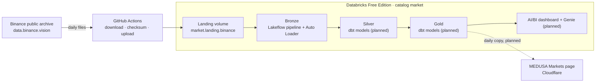

# MEDUSA lakehouse

A daily data pipeline for crypto futures market data. Every morning it loads the previous day's
1-minute candles and market metrics for every Binance USDⓈ-M perpetual into a Databricks
lakehouse, where the history is kept and analysed. Dashboards read the finished tables.

It lives inside the [MEDUSA](../README.md) repository: MEDUSA is the trading journal and backtesting
app; this folder is its market data platform.

## Architecture



| Layer | Holds | Built by |
|---|---|---|
| Landing | Binance's files, unchanged apart from unzip + gzip | [`ingest/download_binance.py`](ingest/download_binance.py) run by GitHub Actions |
| Bronze | Every file line as a row, all columns as text, plus lineage | [`pipelines/bronze/`](pipelines/bronze/) (Lakeflow Declarative Pipeline) |
| Silver | Typed, checked facts and dimensions | [`dbt/`](dbt/) (dbt Core, in progress) |
| Gold | Daily tables the dashboards read | dbt (planned) |

## Documentation

| Page | What's in it |
|---|---|
| [Architecture](docs/architecture.md) | Components, data flow, where each part runs, free-plan limits |
| [Decisions](docs/decisions.md) | Why each tool and design was chosen (and what was left out) |
| [Data dictionary](docs/data-dictionary.md) | Every table and column, with what the data really looks like |
| [Operations](docs/operations.md) | Daily schedule, re-running a day, secrets, what to do when something fails |
| [Glossary](docs/glossary.md) | The data engineering terms used in this project |

### Build log, step by step

| Step | What it built | Status |
|---|---|---|
| [1. DDL scripts](docs/steps/01-ddl-scripts.md) | Catalog, layer schemas and landing volume as versioned SQL | Done |
| [2. Databricks CLI](docs/steps/02-databricks-cli.md) | Command-line access to the workspace | Done |
| [3. Setup job](docs/steps/03-setup-job.md) | Asset Bundle that deploys and runs the DDL | Done |
| [4. Downloader](docs/steps/04-downloader.md) | Download + checksum check for one coin | Done |
| [5. Every coin + upload](docs/steps/05-every-coin-and-upload.md) | All USDT perpetuals, uploaded to the landing volume | Done |
| [6. Daily automation](docs/steps/06-daily-github-action.md) | GitHub Actions load at 06:00 UTC | Done |
| [7. Bronze layer](docs/steps/07-bronze-pipeline.md) | First tables, loaded with Auto Loader | Done |
| [8. dbt setup](docs/steps/08-dbt-setup.md) | dbt installed in a venv and connected to the SQL warehouse | Done |
| 9. Silver candles | Typed, incremental `fct_candle_1m` with tests and source freshness | Next |

## Folder layout

```
lakehouse/
├─ README.md                 this page
├─ databricks.yml            Asset Bundle: every job and pipeline, defined as code
├─ sql/ddl/                  numbered, re-runnable DDL (catalog, schemas, volume)
├─ ingest/                   the downloader that GitHub Actions runs
├─ pipelines/bronze/         the bronze Lakeflow pipeline (SQL)
├─ dbt/                      the dbt project for silver and gold (models, tests, macros)
├─ docs/                     everything linked above
└─ .gitignore                keeps downloaded data and secrets out of Git
```

The daily workflow lives at the repository root in
[`.github/workflows/lakehouse-daily.yml`](../.github/workflows/lakehouse-daily.yml), because that is
the only place GitHub looks for workflows.
