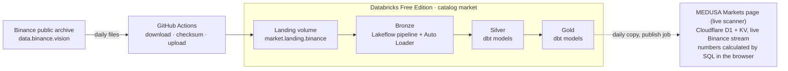

# MEDUSA lakehouse

A daily data pipeline for crypto futures market data. Every morning it loads the previous day's
1-minute candles and market metrics for every Binance USDⓈ-M perpetual into a Databricks
lakehouse, where the history is kept and analysed. MEDUSA's **Markets** page, a live scanner, compares
each market's move today with its own history from these tables ([step 25](docs/steps/25-scanner-page.md)),
and every number on it is calculated by SQL in the browser ([step 26](docs/steps/26-numbers-built-by-sql.md)).

It lives inside the [MEDUSA](../README.md) repository: MEDUSA is the trading journal and backtesting
app; this folder is its market data platform.

## Architecture



| Layer | Holds | Built by |
|---|---|---|
| Landing | Binance's files, unchanged apart from unzip + gzip | [`ingest/download_binance.py`](ingest/download_binance.py) run by GitHub Actions |
| Bronze | Every file line as a row, all columns as text, plus lineage | [`pipelines/bronze/`](pipelines/bronze/) (Lakeflow Declarative Pipeline) |
| Silver | Typed, checked facts and dimensions | [`dbt/models/silver/`](dbt/models/silver/) (dbt Core) |
| Gold | Daily tables the dashboards read | [`dbt/models/gold/`](dbt/models/gold/) (dbt Core) |

## Documentation

| Page | What's in it |
|---|---|
| [Questions and answers](docs/faq.md) | How the daily pipeline works, in short: workflows, schedule, what is re-read, where data is kept |
| [Architecture](docs/architecture.md) | Components, data flow, where each part runs, free-plan limits |
| [Decisions](docs/decisions.md) | Why each tool and design was chosen (and what was left out) |
| [Data dictionary](docs/data-dictionary.md) | Every table and column, with what the data really looks like |
| [Operations](docs/operations.md) | Daily schedule, re-running a day, secrets, what to do when something fails |
| [Glossary](docs/glossary.md) | The data engineering terms used in this project |

### Build log, step by step

| Step | What it built | Status |
|---|---|---|
| [1. DDL scripts](docs/steps/01-ddl-scripts.md) | Catalog, layer schemas and landing volume as versioned SQL | Done |
| [2. Databricks CLI](docs/steps/02-databricks-cli.md) | Command-line access to the workspace | Done |
| [3. Setup job](docs/steps/03-setup-job.md) | Asset Bundle that deploys and runs the DDL | Done |
| [4. Downloader](docs/steps/04-downloader.md) | Download + checksum check for one coin | Done |
| [5. Every coin + upload](docs/steps/05-every-coin-and-upload.md) | All USDT perpetuals, uploaded to the landing volume | Done |
| [6. Daily automation](docs/steps/06-daily-github-action.md) | Daily load with GitHub Actions (now 13:23 UTC, [ADR-021](docs/decisions.md#adr-021-load-a-day-only-after-binance-has-finished-publishing-it), [ADR-023](docs/decisions.md#adr-023-re-check-loaded-days-against-binance-for-a-week)) | Done |
| [7. Bronze layer](docs/steps/07-bronze-pipeline.md) | First tables, loaded with Auto Loader | Done |
| [8. dbt setup](docs/steps/08-dbt-setup.md) | dbt installed in a venv and connected to the SQL warehouse | Done |
| [9. Silver candles](docs/steps/09-silver-candles.md) | Typed, incremental `fct_candle_1m` with tests and source freshness | Done |
| [10. Silver metrics](docs/steps/10-silver-metrics.md) | Typed, incremental `fct_metrics_5m` with tests | Done |
| [11. Coin dimension](docs/steps/11-dim-coin.md) | `dim_coin` with full history (SCD Type 2) from a dbt snapshot | Done |
| [12. Hourly candles](docs/steps/12-silver-hourly-candles.md) | `fct_candle_1h` rolled up from the 1-minute candles | Done |
| [13. Gold: coin_daily](docs/steps/13-gold-coin-daily.md) | One row per coin per day: returns, volatility, volume, taker share, open interest | Done |
| [14. Gold: market_daily and data_health](docs/steps/14-gold-market-and-health.md) | The whole market per day, and how complete each day's data is | Done |
| [15. Backfill](docs/steps/15-backfill.md) | Load 30 past days through the whole pipeline (GitHub Actions matrix + reusable workflow) | Done |
| [16. Gold: unusual_moves and hour_profile](docs/steps/16-gold-unusual-moves-and-hours.md) | Each coin's day against its own history; hour-of-day patterns | Done |
| [17. Daily chain](docs/steps/17-daily-chain.md) | Every morning: download → landing → bronze → dbt, all from GitHub Actions | Done |
| [18. Active coins](docs/steps/18-active-coins.md) | Count only coins that trade: delisted contracts still get flat candles | Done |
| [19. Coin baseline](docs/steps/19-coin-baseline.md) | Each coin's "normal" (yesterday's close, 30-day spread of returns and volume) for the live scanner | Done |
| [20. Hourly history](docs/steps/20-hourly-history.md) | Every USDT perpetual's hourly candles since January 2020 from Binance's monthly files (22,221 files, 15.9 million rows) | Done |
| [21. Silver hourly history](docs/steps/21-silver-hourly-history.md) | Typed archive hours, one continuous series since 2020, the two hourly sources reconciled (and an open/high/low fix it found) | Done |
| [22. Evidence](docs/steps/22-evidence.md) | Every unusual intraday move since 2020 and what followed over 1, 4 and 24 hours, judged by days and on held-back years | Done |
| [23. Serving tables](docs/steps/23-serving-tables.md) | MEDUSA's copy of `coin_baseline` and `event_evidence` in D1, filled through a write-only endpoint with its own token | Done |
| [24. Publish job](docs/steps/24-publish-job.md) | After every transform, gold is copied into MEDUSA and the row counts reconciled | Done |
| [25. Scanner page](docs/steps/25-scanner-page.md) | The live scanner, MEDUSA's Markets page (release 1.6.0, signed-in accounts): live Binance prices against each market's normal, the evidence, Patterns, and where every number comes from | Done |
| [26. Numbers built by SQL](docs/steps/26-numbers-built-by-sql.md) | Every number on the Markets page calculated by SQL in the browser (SQLite) from the live prices and the serving copy; the scanner's answer kept ready-made in Workers KV; a dbt exposure tying the page to its gold models | Done |
| 27. Metric definitions in Databricks | Each number's name, definition and SQL in a versioned table, published to MEDUSA, which runs them | Next |
| 28. Editing the definitions | Change a number's SQL on the page: a preview for everyone, saved by the owner to Databricks with its history | Planned |
| 29. Patterns on SQL, release 1.7.0 | The Patterns view on the same engine; MEDUSA 1.7.0 | Planned |

## Folder layout

```
lakehouse/
├─ README.md                 this page
├─ databricks.yml            Asset Bundle: every job and pipeline, defined as code
├─ sql/ddl/                  numbered, re-runnable DDL (catalog, schemas, volume)
├─ ingest/                   the downloader that GitHub Actions runs
├─ pipelines/bronze/         the bronze Lakeflow pipeline (SQL)
├─ dbt/                      the dbt project for silver and gold (models, tests, macros, the Markets page exposure)
├─ serving/                  the publish job that copies gold into MEDUSA
├─ docs/                     everything linked above
└─ .gitignore                keeps downloaded data and secrets out of Git
```

The workflows live at the repository root in [`.github/workflows/`](../.github/workflows/), because
that is the only place GitHub looks for them: `lakehouse-daily.yml` (every day at 13:23 UTC: load, re-check the previous 7 days, transform),
`lakehouse-backfill.yml` (past days), `lakehouse-history.yml` (Binance's monthly hourly files, one
year per job), and the two they share, `lakehouse-load-day.yml` (download, check, upload) and
`lakehouse-transform.yml` (bronze, freshness, dbt build).
