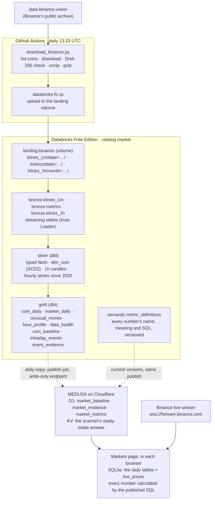

# Architecture

[← Lakehouse home](../README.md)

## What the platform does

Every day it collects the previous day's market data for every Binance USDⓈ-M perpetual future
(about 870 coins), keeps the full history in a lakehouse, and turns it into daily tables that
dashboards analyse: yesterday on its own, and yesterday against the past.

## Data flow

## Where each part runs

| Part | Runs on | Why there |
|---|---|---|
| Download, checksum, upload | GitHub Actions (free for public repositories) | Databricks Free Edition only allows internet access to a short list of trusted sites, so the download has to happen outside it. A fresh Linux machine per run, so nothing is left over between days. |
| Storage, compute, tables | Databricks Free Edition | Unity Catalog, Delta tables, serverless compute, pipelines and dashboards, with no cost. |
| Bronze loading | Lakeflow Declarative Pipeline (serverless, triggered) | Auto Loader loads each new file exactly once and remembers what it has loaded. |
| Silver and gold | dbt Core on the SQL warehouse | SQL models with tests, snapshots, documentation and lineage. |
| Orchestration | GitHub Actions: load, then transform ([ADR-017](decisions.md#adr-017-orchestrate-the-daily-chain-in-github-actions)) | One place for the whole chain, one set of secrets and one failure email. |
| Deploying Databricks resources | Databricks Asset Bundle ([`databricks.yml`](../databricks.yml)) | Jobs and pipelines are defined as code and deployed with one command. |
| Metric definitions | Databricks: `market.semantic.metric_definitions`, every version kept (SCD Type 2), checked by dbt tests in every build ([ADR-029](decisions.md#adr-029-metric-definitions-are-kept-in-databricks-and-published-with-the-data)) | One master copy of what each number means and how it is calculated, kept with the data it describes, versioned and tested like the models. |
| Serving copy | MEDUSA's database (Cloudflare D1): `market_baseline`, `market_evidence` and `market_metrics` (the current definitions), filled by the publish job through `POST /api/market/ingest` ([ADR-024](decisions.md#adr-024-a-write-only-endpoint-for-the-serving-copy)). After each publish the endpoint also saves the scanner's answer, ready-made, in Workers KV ([ADR-026](decisions.md#adr-026-the-scanners-answer-is-kept-ready-made-in-workers-kv)) | MEDUSA's users have no Databricks access, and a page querying Databricks would wake the warehouse on every visit. The endpoint's own token can only replace these tables. Page loads read KV, not D1. |
| Live scanner | MEDUSA's Markets page (`public/markets.js`) on Cloudflare, for signed-in accounts ([ADR-025](decisions.md#adr-025-the-scanner-is-for-signed-in-accounts)), with live prices streamed from Binance (`wss://fstream.binance.com/market/ws/!miniTicker@arr`) to the browser ([ADR-027](decisions.md#adr-027-the-live-layer-runs-in-each-browser)) | Day trading needs today's prices. The browser keeps the serving copy (read through `GET /api/market/scanner`) and the live prices in a SQLite database of its own and calculates every number with SQL ([ADR-028](decisions.md#adr-028-every-number-is-a-sql-query-run-in-the-browser)), using the same rule as `intraday_events` (it reproduces the lakehouse's events exactly). |

## Catalog layout

Unity Catalog names everything `catalog.schema.object`, like a database, schema and table in
SQL Server.

| Object | Kind | Purpose |
|---|---|---|
| `market` | Catalog | The whole platform |
| `market.landing` | Schema | Raw files |
| `market.landing.binance` | Volume (managed) | Daily files, one folder per dataset and day: `klines_1m/date=2026-10-19/BTCUSDT-1m-2026-10-19.csv.gz` |
| `market.bronze` | Schema | Raw rows: `klines_1m`, `metrics`, `klines_1h` (monthly history files) |
| `market.silver` | Schema | Typed, checked tables (dbt), including `fct_candle_1h_archive` and the continuous hourly series `int_candle_1h_all` |
| `market.gold` | Schema | Tables the live scanner and analysis read (dbt): daily tables, each coin's `coin_baseline`, and the scanner's evidence (`intraday_events`, `event_evidence`) |
| `market.semantic` | Schema | Definitions about the data, not data: `metric_definitions`, every version of each Markets number's name, meaning and SQL ([DDL](../sql/ddl/004_semantic.sql)) |

## Daily timeline (UTC)

| Time | What happens |
|---|---|
| ~06:40–07:40 | Binance publishes the previous day's metrics files |
| ~08:00–12:00 | Binance publishes the previous day's 1-minute candle files (measured 14–20 October 2026) |
| 13:23 | GitHub Actions downloads every coin's files (~1 minute), checks they are all published and match their checksums, and uploads them with the day's manifest (~2.5 minutes in total); a day that isn't fully published stops here ([ADR-021](decisions.md#adr-021-load-a-day-only-after-binance-has-finished-publishing-it)) |
| Right after | Recheck: the previous 7 days' manifests are compared with Binance's fingerprints, and changed or new files are loaded under new names ([ADR-023](decisions.md#adr-023-re-check-loaded-days-against-binance-for-a-week)) |
| Right after | The same run's `transform` job: bronze pipeline, `dbt source freshness`, `dbt build` (silver and gold, with tests) |
| Right after | Publish to MEDUSA: `coin_baseline`, `event_evidence` and the current metric definitions copied through the write-only endpoint, row counts reconciled (about 7 seconds) |

## Volumes of data

| Dataset | Per day | Notes |
|---|---|---|
| 1-minute candles | ~872 files, 1,255,680 rows, ~33 MB gzipped | 1,440 rows per coin |
| Market metrics (open interest, long/short ratios) | ~744 files, ~205,000 rows, ~9 MB gzipped | Should be 288 rows per coin; many coins have fewer |
| A year of candles | ~460 million rows | Why 1-minute data is kept for a limited time (see [retention](decisions.md#adr-011-keep-1-minute-candles-for-a-limited-time)) |

## Free Edition limits that shaped the design

- Serverless compute only; one SQL warehouse, size 2X-Small.
- At most 5 job tasks at a time, and one active pipeline per pipeline type.
- A daily fair-use quota: going over shuts compute off for the rest of the day.
- Internet access from inside Databricks is limited to trusted sites.
- Non-commercial use only.

## What's left out on purpose

See [Decisions](decisions.md#adr-012-tools-left-out-on-purpose): Airflow, PySpark, Kafka, Great
Expectations, Terraform and a second warehouse each have a reason.
