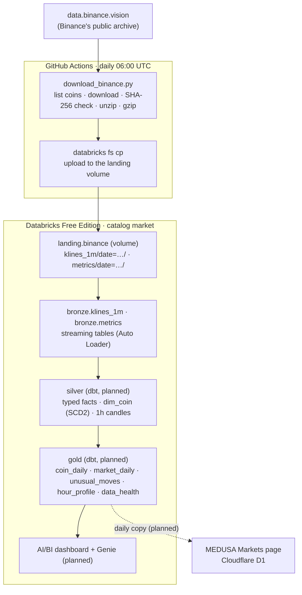

# Architecture

[← Lakehouse home](../README.md)

## What the platform does

Every day it collects the previous day's market data for every Binance USDⓈ-M perpetual future
(about 870 coins), keeps the full history in a lakehouse, and turns it into daily tables that
dashboards analyse: yesterday on its own, and yesterday against the past.

## Data flow

## Where each part runs

| Part | Runs on | Why there |
|---|---|---|
| Download, checksum, upload | GitHub Actions (free for public repositories) | Databricks Free Edition only allows internet access to a short list of trusted sites, so the download has to happen outside it. A fresh Linux machine per run, so nothing is left over between days. |
| Storage, compute, tables | Databricks Free Edition | Unity Catalog, Delta tables, serverless compute, pipelines and dashboards, with no cost. |
| Bronze loading | Lakeflow Declarative Pipeline (serverless, triggered) | Auto Loader loads each new file exactly once and remembers what it has loaded. |
| Silver and gold | dbt Core (planned) | SQL models with tests, documentation and lineage. |
| Deploying Databricks resources | Databricks Asset Bundle ([`databricks.yml`](../databricks.yml)) | Jobs and pipelines are defined as code and deployed with one command. |
| Public dashboard | MEDUSA on Cloudflare (planned) | Recruiters can't sign in to a Databricks workspace; a daily copy of the small gold tables is served from MEDUSA's own database. |

## Catalog layout

Unity Catalog names everything `catalog.schema.object`, like a database, schema and table in
SQL Server.

| Object | Kind | Purpose |
|---|---|---|
| `market` | Catalog | The whole platform |
| `market.landing` | Schema | Raw files |
| `market.landing.binance` | Volume (managed) | Daily files, one folder per dataset and day: `klines_1m/date=2026-10-19/BTCUSDT-1m-2026-10-19.csv.gz` |
| `market.bronze` | Schema | Raw rows: `klines_1m`, `metrics` |
| `market.silver` | Schema | Typed, checked tables (dbt) |
| `market.gold` | Schema | Tables the dashboards read (dbt) |

## Daily timeline (UTC)

| Time | What happens |
|---|---|
| ~00:00–05:00 | Binance publishes the previous day's files |
| 06:00 | GitHub Actions downloads every coin's files (~1 minute), checks them and uploads them (~2.5 minutes in total) |
| Planned | The Databricks job runs bronze → silver → gold, then the dashboards and the MEDUSA copy refresh |

## Volumes of data

| Dataset | Per day | Notes |
|---|---|---|
| 1-minute candles | ~872 files, 1,255,680 rows, ~33 MB gzipped | 1,440 rows per coin |
| Market metrics (open interest, long/short ratios) | ~744 files, ~205,000 rows, ~9 MB gzipped | Should be 288 rows per coin; many coins have fewer |
| A year of candles | ~460 million rows | Why 1-minute data is kept for a limited time (see [retention](decisions.md#adr-011-keep-1-minute-candles-for-a-limited-time)) |

## Free Edition limits that shaped the design

- Serverless compute only; one SQL warehouse, size 2X-Small.
- At most 5 job tasks at a time, and one active pipeline per pipeline type.
- A daily fair-use quota: going over shuts compute off for the rest of the day.
- Internet access from inside Databricks is limited to trusted sites.
- Non-commercial use only.

## What's left out on purpose

See [Decisions](decisions.md#adr-012-tools-left-out-on-purpose): Airflow, PySpark, Kafka, Great
Expectations, Terraform and a second warehouse each have a reason.
