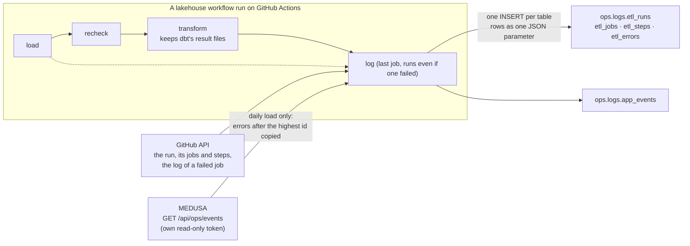

# Step 31: Operations logs in the lakehouse

[← Lakehouse home](../../README.md) · [← Step 30](30-catalog-layout.md)

| | |
|---|---|
| **Built** | 2026-10-25 and 26 |
| **Commits** | `2386679` (31.1 tables, 31.2 runs logged) · `b64a174` (31.3 MEDUSA's failures) · `7b9506d` (a fix) · `e83a649` (31.4 the ETL logs as related tables) · the error-message fix and these docs |
| **Files** | [`sql/ddl/007_ops_logs.sql`](../../sql/ddl/007_ops_logs.sql) and [`008_etl_logs.sql`](../../sql/ddl/008_etl_logs.sql) (the tables and views) · [`sql/ops/001_bronze_loads.sql`](../../sql/ops/001_bronze_loads.sql) (the bronze pipeline's own log) · [`ops/log_pipeline_run.py`](../../ops/log_pipeline_run.py) (writes each run) · [`ops/ship_app_events.py`](../../ops/ship_app_events.py) (copies MEDUSA's errors) · [`ops/databricks_sql.py`](../../ops/databricks_sql.py) · [`lakehouse-log-run.yml`](../../../.github/workflows/lakehouse-log-run.yml) and the four lakehouse workflows · MEDUSA: [`src/ops.js`](../../../src/ops.js), `src/worker.js`, `src/http.js`, `public/markets.js` |
| **Decisions** | [ADR-033](../decisions.md#adr-033-operations-logs-append-only-tables-in-databricks-filled-from-github-and-medusa) |

## Goal

The owner's note: a log table in Databricks for every build or ETL failure, and another for failures of
the dashboard (MEDUSA's Markets page). Then, once the first version ran, a second note: make the logs
say more (was a run started by hand?), and give the ETL runs a structure: a table of every day's runs,
connected to a table of the jobs each run ran, connected to a table of every step of those jobs, beside
the table of ETL errors and the table of MEDUSA's errors.

Until now, a failure was only in GitHub's run history (kept 90 days, one run at a time) and its failure
email, and MEDUSA's errors only in each account's Logs tab. Now both are tables that SQL can count,
join and trend.

## Concepts

| Concept | Here | In SQL Server terms |
|---|---|---|
| **Append-only audit log** | `delta.appendOnly = true`: Databricks refuses `UPDATE` and `DELETE` on the table, for everyone, so a log can't be changed after the fact. Unity Catalog has no insert-only permission (`MODIFY` also allows updates and deletes), so the table itself enforces it | A table with an `INSTEAD OF UPDATE, DELETE` trigger that refuses, or a ledger table (`APPEND_ONLY = ON`) |
| **Header, detail, sub-detail** | `etl_runs` → `etl_jobs` → `etl_steps`, like an order, its lines and their items. Each child carries its parent's key | `Orders` → `OrderLines` with foreign keys |
| **Informational keys** | Primary and foreign keys declared in Unity Catalog but not enforced: the writer keeps them true, and Catalog Explorer draws the relationships from them | `ALTER TABLE ... NOCHECK CONSTRAINT`: declared, documented, not checked |
| **Natural, deterministic keys** | A key made from where the row came from (`gh:<run>:<attempt>:<job>:<step>`), so any writer, at any time, makes the same key for the same thing | A business key instead of an `IDENTITY` |
| **Idempotent insert** | `INSERT ... SELECT ... WHERE NOT EXISTS` on the key: writing the same run twice adds nothing | The same pattern, or `MERGE ... WHEN NOT MATCHED` |
| **Incremental extract with a high-water mark** | MEDUSA's errors are copied after the highest row id already in Databricks. The mark is the insert order (the id), not the time of the error, so a line that arrives late is still copied | `WHERE id > @last_id` in an SSIS package, with the last id kept in a control table |
| **Run metadata** | What a run, job and step did comes from GitHub's API after the fact, not from code added to every job | Reading `msdb.dbo.sysjobhistory` for SQL Agent jobs |
| **Artifact** | A file a GitHub job keeps for later jobs of the same run: the transform keeps dbt's result files for the log job | A file share between SSIS packages |

## The tables

```
ops.logs
├─ etl_runs          one row per run (attempt) of a lakehouse workflow
│  ├─ etl_jobs       one row per job of the run                     job_key → run_key
│  │  └─ etl_steps   one row per step of the job                    step_key → job_key
│  └─ etl_errors     each failed step and failed or warning dbt check, linked to its run, job and step
├─ app_events        MEDUSA's errors: those its pages reported and those its server hit
├─ daily_etl_status  view: one row per day, did the scheduled run happen, when, with what result
├─ recent_failures   view: every error of the last 30 days, ETL and MEDUSA
└─ bronze_loads      view: every bronze load, its rows and data quality checks (the pipeline's own log)
```

| Table | Key | What a row says |
|---|---|---|
| `etl_runs` | `gh:<run id>:<attempt>` | Which workflow and run number; `run_type` (`scheduled`, `manual`, `re-run`) and `triggered_by` in words; for a scheduled run, the time the schedule set it for and how late GitHub started it; what was typed when started by hand; the day or days of data; the result; when, how long; how many jobs succeeded, failed, were skipped or cancelled; one line for a person |
| `etl_jobs` | `<run_key>:<job id>` | The job (load, recheck, transform, a backfill day), its result, duration, the day it loaded and the step that failed |
| `etl_steps` | `<job_key>:<step number>` | Each step's result and duration; the dbt steps also carry their counts (models built, tests passed, failed, warned) |
| `etl_errors` | `<step_key>:step` or `<job_key>:dbt:<node>` | A failed step with the line that says why and the end of its output (GitHub hides secrets in logs), or a dbt model, snapshot, test or freshness check that failed or warned |
| `app_events` | `browser:<id>`, `server:<id>` | An error a MEDUSA page reported (a failed Markets query, the SQL engine, a failed call, a Lab run) or one its server hit (a 5xx answer, a refused ingest token, a failed import). Never which account |

## How a run is logged



## Built in four parts

### 31.1 The ops tables

`007_ops_logs.sql` created the first two tables (`pipeline_events`, one table for everything, and
`app_events`) and the view `recent_failures`, all append-only with CHECK constraints (a `severity` must
be `info`, `warning` or `error`, and so on), added with `ALTER TABLE`, the only way Databricks takes
them. `sql/ops/001_bronze_loads.sql` made the view `bronze_loads` over the bronze pipeline's own event
log (the `event_log()` table function), run by the new job `lakehouse-ops-views` because it needs the
bronze tables to exist.

### 31.2 Every run logged

A reusable workflow, `lakehouse-log-run.yml`, became the last job of the daily load, the backfill, the
history load and a transform started by hand (`if: always()`, so it runs after a failure too). It reads
its own run from GitHub's API and writes what happened. When the transform is called by another
workflow, its own log job steps aside (the caller logs the whole run). Logging never fails a run: if
Databricks can't be reached, the step only warns.

### 31.3 MEDUSA's failures

- **The page.** A failed Markets query (a card's **!**, *The query failed* in a table) or a run that
  failed now goes into MEDUSA's log as an error line, once per page and error (the queries run every
  second).
- **The server.** `src/ops.js` keeps `server_events` in D1: answers of 500 and above, refused ingest
  tokens, failed scheduled imports and unexpected crashes. The same error is stored once a minute at most
  (once in 6 hours for imports), the newest 2,000 rows are kept, and no account is recorded.
- **The export.** `GET /api/ops/events`, with its own read-only token (`OPS_EXPORT_TOKEN`), returns the
  pages' error lines and the server events after the ids it is given, 500 of each at a time, with
  anything that looks like an email address replaced.
- **The copy.** The daily load's log job runs `ops/ship_app_events.py`: it asks Databricks for the
  highest id already copied per source, fetches what is newer, and inserts it.

### 31.4 The ETL logs as related tables

The owner asked for more: whether a run was manual, and a structure of runs, their jobs and their steps.
`008_etl_logs.sql` added `etl_runs`, `etl_jobs`, `etl_steps` and `etl_errors` (append-only, keys
declared), the views `daily_etl_status` and a new `recent_failures`, and dropped `pipeline_events`
(007 has run and is not edited, ADR-006). The logger was rewritten for the four tables, and the
transform keeps dbt's result files as an artifact for the log job. Started by hand, the log workflow
fills the tables with every lakehouse run GitHub still has: it was run once, from 19 October, so the
history starts with the first daily load.

## Result

| Check | Result |
|---|---|
| Tables | `ops.logs`: `etl_runs`, `etl_jobs`, `etl_steps`, `etl_errors`, `app_events`, and the views `daily_etl_status`, `recent_failures`, `bronze_loads`; each table append-only (`delta.appendOnly = true`) with its CHECK constraints and keys |
| History filled | 18 run attempts since 19 October, 67 jobs, 378 steps, 3 errors |
| `daily_etl_status` | One row per day; the scheduled time as the workflow file said then (06:00 UTC on 21 Oct, 13:00 on 22 Oct, 13:23 since), GitHub's delay (318, 283, 271, 200, 223 minutes), 21 Oct with 2 attempts (a failed run and its re-run), 20 Oct *missing* (the schedule began on the 21st) |
| `etl_errors` | The three real failures: two uploads on 20 Oct (*default auth: cannot configure default credentials*, the GitHub secrets weren't set) and the download on 21 Oct (*Connection reset by peer*), each with the step's output |
| `app_events` | 48 error lines from MEDUSA's pages copied on the first run (Lab Python runs, 18 to 20 Oct); server events from 31.3 on |
| dbt | A transform's step rows carry dbt's counts: 15 models and snapshots built, 131 tests passed |
| MEDUSA, locally | Export refused without the token; 3 refused ingests in a minute stored once; a 503 stored as a `metrics` event; only error lines exported, an email replaced, no account; a broken definition logged once per page |
| Without writing | Every SQL statement planned with `EXPLAIN`; each INSERT's `SELECT` run on real rows; both views run on the real history before the tables existed |

## Problems we hit

- **The logger logged itself.** In a daily run, the transform's own log job is skipped (the daily load
  logs the run), and the first logger wrote that skipped job as a second *transform skipped* row,
  because it cut every job name at ` / `. Log jobs are now left out and nested names kept whole. The wrong
  row could not be deleted (append-only); it went when `pipeline_events` was replaced.
- **A day without a date.** The daily run's dbt row had no `data_date`: the transform didn't know which
  day the run loaded. In the related tables the log job, which knows the day, writes every row.
- **The schedule moved.** A view that assumed today's 13:23 showed 21 October as *124 minutes early*:
  that day the schedule was 06:00. Each run now reads its schedule from the workflow file at the commit
  it ran, so the delay is measured against the schedule of the time.
- **A re-run belongs to its day.** A run re-run in the evening would have counted as started then. The
  view takes the start from the first attempt and the result from the last.
- **"Process completed with exit code 1."** GitHub's last line says nothing. The logger now keeps only
  the step's own output (no colour codes, no listing of the step's environment) and takes the line that
  says why: *Connection reset by peer*. The three rows written before that keep GitHub's line as their
  message, with the cause in their details: the table is append-only.
- **GitHub's limit.** Without a token, GitHub answers 60 API calls an hour; trying the history twice from
  a computer used them up. In Actions the job's own token is used, and a failed job's log needs it anyway.
