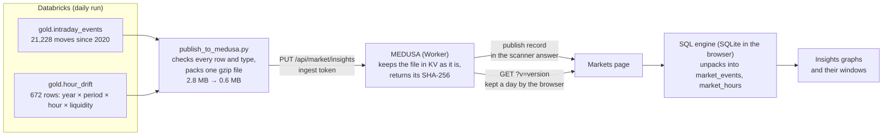

# Step 32: Insights, graphs that look for an edge

[← Lakehouse home](../../README.md) · [← Step 31](31-ops-log-tables.md)

| | |
|---|---|
| **Built** | 32.1: 2026-10-26 to 30 · 32.2.1 and 32.2.2: 2026-11-01 · 32.2.3 and 32.3: 2026-11-02 · 32.4: 2026-11-05 · the rest of 32.2: when open interest has years of history |
| **Commits** | 32.4: `fe97191` · 32.1: `26a06bb` (the graph engine, the Insights view and these docs) · the live results · 32.2.1: `5ba4cbe`, `82339e1`, `cedf351`, `0f8faeb`, `849876a`, `d35f7f8` |
| **Files** | [`dbt/models/gold/hour_drift.sql`](../../dbt/models/gold/hour_drift.sql) (the market by hour, every year) and its test · [`serving/publish_to_medusa.py`](../../serving/publish_to_medusa.py) (the Insights file) · [`sql/seed/003_metric_definitions_insights.sql`](../../sql/seed/003_metric_definitions_insights.sql) (version 1 of the 16 definitions) · `databricks.yml` (the seed task) · MEDUSA: [`public/markets-charts.js`](../../../public/markets-charts.js) (the graphs), `public/markets.js`, `public/markets-metrics.js`, `public/markets-sql.js`, `public/markets-window.js`, `src/market.js`, `src/metrics.js`, `src/worker.js` · [`dbt/models/gold/move_outcomes.sql`](../../dbt/models/gold/move_outcomes.sql) (how moves turned out) and its test |
| **Decisions** | [ADR-041](../decisions.md#adr-041-the-breakout-watch-joins-a-daily-range-from-the-lakehouse-with-the-live-price) (32.4) · [ADR-034](../decisions.md#adr-034-the-insights-history-goes-to-medusa-as-one-gzip-file-kept-as-it-is) · [ADR-035](../decisions.md#adr-035-a-graph-is-a-definition-sql-plus-a-chart-spec-drawn-as-svg-by-the-page) · [ADR-037](../decisions.md#adr-037-market-type-comes-from-a-reference-list-and-only-tested-markets-get-a-verdict) · [ADR-038](../decisions.md#adr-038-how-far-moves-went-is-a-gold-table-not-a-query-on-the-page) |

## Goal

The owner's note: graphs and diagrams that help find an edge (not price charts), made from SQL, that
change when the values do, whose SQL can be edited, and that can be drilled into, each drill opening a
page of its own. Then more graphs and tables, and on-chain data as part of the Markets module, from as
many free sources as there are.

Three parts:

| Part | What | State |
|---|---|---|
| **32.1** | The graph engine and the first seven graphs: the moves since 2020 published to MEDUSA, a graph type in the definitions, drawn by the page, drillable into windows | Done |
| **32.2** | More graphs and tables from data already in the lakehouse: a playbook per live unusual market, crowded or alone, positioning (open interest, long/short, aggressive buying), regime gauges, a risk table | Next |
| **32.3** | On-chain: stablecoins, chain activity, exchange flows, valuation and fees from the free sources, into the lakehouse with the same held-back test | After 32.2 |

## Concepts

| Concept | Here | In SQL Server terms |
|---|---|---|
| **A graph is a query plus a chart spec** | A definition (step 27) whose display has a `chart`: which columns go on which axis, how they are coloured, what a click opens. The SQL decides *what*, the spec decides *how it looks* | An SSRS chart: a dataset query plus the chart's properties |
| **Drill-down** | A click on a bar, cell or point opens a window that runs other definitions with what was clicked (a year, an hour, a size band) as parameters. The window can be drilled into again | An SSRS drill-through report with parameters |
| **NULL means "no filter"** | `WHERE (:year IS NULL OR year = :year)`: one query serves every combination of picks | Optional stored-procedure parameters, `@Year IS NULL OR Year = @Year` |
| **Median, not only average** | `MEDIAN()` (both in the browser's SQLite and in Databricks): the middle move, which a few huge moves can't drag | `PERCENTILE_CONT(0.5) WITHIN GROUP` |
| **Additive sums** | `gold.hour_drift` keeps `days`, `sum_return` and `sum_sq_return`, so any group of rows pools exactly: mean = sum ÷ days, variance from the sum of squares | Storing SUM and COUNT in an aggregate table instead of AVG, so it can be rolled up again |
| **Serving a snapshot file** | The history goes to MEDUSA as one gzip file, kept as it is in KV and unpacked by the browser (ADR-034) | Exporting a table to a file for a client instead of opening a connection to it |
| **Result caching** | A query that reads no live table is run once and kept until its SQL or the data changes, instead of every second | A report snapshot, refreshed when its data changes |

## The graphs

| Graph | The question | How to use it |
|---|---|---|
| **Every market right now** (live) | What is unusual now, and is volume behind it? | Today's move in σ against volume versus a usual day, for every market, once a second. Blue: unusual and its kind of move has a pattern that held up; orange: unusual with no tested edge. A click opens the market |
| **Every kind of move at a glance** | Which kinds of move have a tested edge? | Each kind of move by horizon, coloured by what it did next (each column on its own scale, grey where there are too few days), with its verdict. A click opens its moves |
| **Year by year** | Is a pattern there every year, or in one lucky year? | Median and average next move per year. Up moves turned back every year, median −0.55% to −1.09% over 4 hours |
| **Spread of outcomes** | If I fade, how often do I get hurt badly? | Moves per 1% step. 6.5% of up moves ran another 10% or more within 4 hours: the tail a fade has to survive |
| **By the hour of the move** | Does the time of day matter? | Median by UTC hour: moves starting 01 to 13 UTC turned back about 1 to 2%, those at 19 to 22 UTC hardly at all (−0.05 to −0.13%). An idea to test, not a pattern yet |
| **By size and liquidity** | Do big and small markets behave differently? | Median by size band and liquidity: 6σ moves on small markets turned back most (−4.3%), where trading costs are also highest |
| **The market by hour of the day** | Do some hours lean up or down, and does it last? | 2020–2024 against 2025 on, in basis points. 05, 06 and 21 UTC rose in 2020–2024 (t 2.3 to 3.1); none of them kept it from 2025 |

Each opens windows of its own:

| Window | Opened by | What it shows |
|---|---|---|
| **The moves picked** (`moves`) | A bar, cell or row of the moves graphs | The middle move, the spread of outcomes, year by year (unless one year was picked), and the newest moves; a row opens every past move of that market |
| **The market at an hour** (`drift`) | An hour of the market-by-hour graph | That hour year by year, and by liquidity in 2020–2024 against 2025 on |

Every graph and window has a **‹›** button like Today's numbers: the query as it runs, its version,
Preview, Save, History and the copy for Databricks (the Insights tables have no D1 copy).

## How the history reaches the page

- **Built in 32.1:** `gold.hour_drift`, a new model. The existing `hour_profile` answers the same
  question per coin but only from the minute candles (since September 2026); this reads the whole hourly
  series since 2020. Judged by days, like the evidence: the market's move in each hour of each day (every
  trading coin's return, each counted once and clipped to ±10%), then statistics over days.
- **The file.** The publish job reads both tables, checks every column's type and that no key repeats,
  writes them as JSON with rows as lists, packs it with gzip and sends it. MEDUSA doesn't open it (that
  would take more CPU time than the free plan gives), stores it in KV with its day and row counts, records
  the publish, and reports the file's SHA-256: the job fails unless it matches. The scanner answer carries
  the publish record, so a page asks for exactly that version and the browser keeps it a day.
- **The page.** The file is fetched only when Insights (or a graph's window) is opened. The SQL engine
  unpacks it in its own thread into two tables with the lakehouse's column names, so a query runs in
  Databricks as it is.

## Built in part 32.1

- **The model and its test.** `hour_drift.sql`, documented in `_gold.yml` (tests on period and liquidity)
  and `assert_hour_drift_valid.sql` (one row per key, hours 0 to 23, no group with more days than *all*).
- **The publish job.** `build_insights()` and `send_insights()`; `--insights-file` only builds the file
  (to look at it, or to load it into a local MEDUSA).
- **MEDUSA's server.** `PUT /api/market/insights` (the ingest token; refuses a body that isn't gzip, a
  wrong day or wrong row counts) and `GET /api/market/insights` (signed in only; `?v=` must match for
  the browser to keep it).
- **The definitions.** Three shared steps (`moves`, `moves_picked`, `hour_stats`), seven graphs and six
  window parts, in `markets-metrics.js` and as version 1 in `market.semantic.metric_definitions`
  (`003_metric_definitions_insights.sql`). Seven new parameters: `:direction` and `:horizon` (the choices
  at the top), `:year`, `:hour`, `:bucket`, `:z_band`, `:liquidity` (what a click picked; `:symbol`
  already existed). The page, MEDUSA's save check and the editor accept them.
- **The graphs.** `markets-charts.js` draws a result as SVG: bars (one or more series, or coloured by
  sign), lines, a scatter (with a log axis) and a heatmap (with its colour scale per column if asked).
  Hover or keyboard focus shows a mark's details; every graph can be read as a table under it.
- **The page.** An Insights view with Up/Down moves and Next 1/4/24 h; windows for each graph and for
  the drills; a result that reads no live table is kept instead of run every second (the Insights
  graphs read 21,000 rows: the engine runs only the live graph each second).

## Result

| Check | Result |
|---|---|
| `hour_drift` | Run read-only on the whole history before it was a model: 2,469 days, 672 rows. In 2020–2024 hours 05 (+6.5 bp, t 3.1), 06 (+5.3 bp, t 2.6) and 21 (+5.5 bp, t 2.3) rose; from 2025 none kept it (−0.1, −3.7 and +2.2 bp, t between −1.3 and 0.7) |
| The file | 21,228 moves and 672 hour rows, 2.77 MB of JSON, 0.58 MB packed; every type checked |
| MEDUSA, locally | Refused without a token, with a wrong one, with a body that isn't gzip, a bad day or bad row counts; the file stored byte for byte (same SHA-256); signed-out readers refused; `?v=` current kept a day, otherwise not kept; the scanner answer carries both publish records |
| The graphs | Every query run on the real file in the browser's SQLite (8 to 130 ms) and, copied, in Databricks: the same results (one move of 13,576 lands in the next 1% step, from the file's rounding) |
| The page | All seven graphs drawn; the live map with 669 markets; drills by year, hour, size and liquidity, outcome step and market; the toggles redraw a window; an edited graph previewed next to the current one; no horizontal scrolling at phone width; no console errors |
| Seed | Planned with `EXPLAIN` in Databricks; no `;` in any text (the statement splitter) |
| Live, the definitions | 33 current definitions in `market.semantic.metric_definitions` (17 before, 16 added; 7 of them shared steps), versions without gaps, every display valid JSON |
| Live, the first run | **Lakehouse transform** run 7, started by hand, 4 min 11 s: `hour_drift` built (672 rows, 2020-01-21 to 2026-10-27), 16 models and snapshots, 139 tests passed (131 before, 8 new), no warnings or errors; published `market_baseline` 753, `market_evidence` 60, `market_metrics` 33, `market_events` 21,306, `market_hours` 672, every row reconciled |
| Live, the schedule | The next daily load (30 October, loading the 29th) republished everything on its own at 18:51 UTC, the Insights file with it (lakehouse day 2026-10-29) |

## Problems we hit

- **SQL that runs in two places.** The graphs run in the browser's SQLite and are copied to Databricks.
  `MEDIAN`, `CONCAT`, `FLOOR` and `SQRT` exist in both; percentiles don't (`percentile_cont` in neither
  the same way), `EXISTS` inside a `CASE` may not run in Databricks (the live map uses a join instead),
  and `FLOOR` returns a decimal in SQLite, so the 1% step is cast to an integer before it becomes a label.
- **A heatmap washed out.** One colour scale for the next hour (moves of about 0.2%) and the next 24
  hours (up to 20%) left the hour column grey. The scale now stops at the 90th percentile of sizes and,
  for the patterns map, is set per column.
- **The loudest cells were the weakest.** The groups with too few days had the most extreme averages and
  drew the eye. They are grey now.
- **Running 21,000 rows every second.** The engine reran every query each second. A result that reads no
  live table is now kept until its SQL or the data changes.
- **A test that never ended.** Importing the page's code in Node kept the process alive (its channel to
  other tabs); the local tests end with `process.exit`.

- **Binance skipped a day while this was deployed.** Its archive has no candles for 28 October (see
  below), which stopped the daily runs of 29 October. The Insights work didn't depend on it: a transform
  by hand rebuilt everything from the data already loaded.

## A hole in the history: 28 October

Binance's daily archive has no 1-minute candles (nor 1-day, mark or index candles, nor aggregated trades)
for 2026-10-28, for any coin; its metrics and raw trades for that day are there, and the days either side
were published on time. The candles exist: Binance's live API returns all 1,440 for Bitcoin. Until it is
filled:

- The daily runs of 29 October stopped at the download check (*NOT READY klines_1m 2026-10-28*), as
  designed (ADR-021), and the next day's run loaded the 29th.
- Gold has no row for the 28th. The 29th has no daily return, because the day before is missing, so
  `market_daily` shows no breadth for it, `data_health` counts all 887 coins as new, and
  `intraday_events` has no moves on the 28th or 29th.
- **Nothing on the page shows this.** The status line gives the newest day, and the 139 dbt tests check
  the rows that exist, not the days that don't. The recheck only re-checks days already loaded, so
  nothing fills the day by itself. [Step 32a](32a-missing-days.md) fixes all three: a missing-days check,
  a warning on Markets and a catch-up in the daily load.

## 32.2.1: what kind of market each move is

Binance's stock and commodity perpetuals began in December 2025. Until now they were mixed into every
move, and the verdicts on the page, chosen on 2020 to 2024, were shown on them too. So the first part of
32.2 puts the market's type on each move, splits the graphs by it, and stops showing a verdict that was
never tested on that kind of market.

**What the numbers said** (Databricks, 2026-10-31, using Binance's own labels):

| Moves over the next 4 hours, from December 2025 | Moves | Median | Ended higher |
|---|---:|---:|---:|
| Crypto, up | 5,146 | −0.87% | 41% |
| Crypto, down | 1,823 | +0.43% | 55% |
| Stocks, up | 340 | +0.04% | 51% |
| Stocks, down | 264 | +0.01% | 50% |

Crypto's unusual moves tend to turn back. On stocks so far it is a coin toss, so a *fade* verdict on a
stock was claiming something the data doesn't show.

| Concept | Here | In SQL Server terms |
|---|---|---|
| **Reference data** | A short list that describes other data and rarely changes: `dim_market_type`, one row per symbol | A lookup table |
| **dbt seed** | A CSV file in the repository that `dbt build` loads as a table. Changes are reviewed and versioned like code | A lookup table filled by a script kept in source control |
| **A key can change meaning** | `MDTUSDT` was a crypto token until 2024 and has been Medtronic since 2026. The type therefore depends on the date of the move, not only the symbol | A business key reused for a new entity, handled with effective dates |
| **Same population for the claim and the test** | A verdict can only describe the markets it was tested on. Stocks have no 2020 to 2024 years, so they can't be tested by this rule at all | A report that filters to the rows its definition covers |

**What was built:**

- **`silver.dim_market_type`,** a dbt seed of 924 markets: 683 crypto, 221 stock, 12 other (indices, a currency,
  pre-IPO markets) and 8 commodity. Binance's archive doesn't say what a market is, only its live contract list
  does, and that API can't be relied on from GitHub's servers. So
  [`ingest/refresh_market_types.py`](../../ingest/refresh_market_types.py) is run on a person's computer and the
  file is committed. A market Binance has delisted stays in the file, and the 31 that had already gone were added
  by hand from the lakehouse's own history.
- **`market_type` on `gold.intraday_events`.** A stock or commodity contract's moves before its listing day are
  crypto, which is how the 19 moves of the old MDT token stay crypto. A market not in the list is `unknown`.
- **A warning, `assert_market_types_known`,** when a trading market isn't in the list yet. Until the list is
  refreshed, its moves stay out of the evidence and it shows as *not tested*: the safe side.
- **`event_evidence` keeps crypto and other markets only.** Stocks and commodities have no moves in the in-sample
  years, so leaving them out changes nothing that chose a side.
- **The page.** `flagged` gains `tested`. A stock or commodity shows *not tested* in place of a verdict, and isn't
  counted as being in a pattern. Seven definitions moved to version 2, the first new versions made by a seed:
  [`004_metric_definitions_market_type.sql`](../../sql/seed/004_metric_definitions_market_type.sql) closes
  version 1 and adds version 2 in one `MERGE`, the way a save on the page does.

**Result before the live run:**

| Check | Result |
|---|---:|
| Verdicts changed, of 60 | 0 |
| Sides changed | 0 |
| In-sample numbers changed | 0 |
| Moves in the evidence | 20,721 of 21,373 (606 stock and 46 commodity moves left out) |

The 5 patterns that held up all still hold, and their results from 2025 improve slightly, for example down 4–6σ on
mid-sized markets over 1 hour from +3.96% to +4.71%. The same comparison also confirmed why `other` stays in:
removing the index markets too shifted 2020 to 2024 and flipped borderline verdicts, which is exactly what this
change must not do.

The page was tested locally with the real 21,373 moves: with *Stocks* chosen, *Year by year* draws 340 up moves,
median +0.04%, average +0.37%, 51% kept going, the same as Databricks. There was no real unusual stock at the time
of the test, so Apple and gold were made unusual on the local copy only: both show *not tested* with no verdict,
while crypto rows keep theirs.

**Limits:**

- The list has to be refreshed by hand. New stock perpetuals only reach a z after 20 days of history, and the
  warning says when one is missing.
- Stocks can't be tested by this rule until enough years pass. A test of their own, on their own short history,
  is a separate question for later.

### The filter everywhere, and a publish that arrives

After the first version went live, the owner chose Stocks and nothing changed: 2020 still showed 227 moves. Two
separate things were wrong.

**The page was holding the old definitions.** Everything live was right: `moves` version 2 and the Insights file
with its 606 stock moves were both there from 23:16 UTC. But a browser kept the daily answer for 5 minutes, and an
open page only asked again every 30, so a page opened before the publish went on running version 1, showing a filter
that did nothing. Now a browser keeps the answer for 1 minute, and an open page asks every 5 minutes, loading only
if the publish records changed, so kept results aren't thrown away for nothing. An open page was left running during
the test: it picked up the new definitions by itself at the 5-minute mark, with no reload.

**Some numbers never had the filter.** They read tables with no market type:

| Graph or table | What changed |
|---|---|
| The market by hour of the day, and its window's two tables | `gold.hour_drift` gains `market_type`, each with an `all` row. `hour_stats` and `drift_by_year` read `market_type = :kind` |
| Every kind of move at a glance | Built from the moves of the type chosen instead of from `market_evidence`, which has no type. Its verdicts still come from the evidence; stocks and commodities show *not tested* |
| Patterns: *Right now* and *Now* | Count markets of the type chosen. For stocks and commodities the view says they aren't tested |

The filter now shows on all three views. **Only the Bitcoin card ignores it, on purpose:** it is the reference
point whatever type is chosen.

| Check | Result |
|---|---:|
| `hour_drift`'s `all` rows against the table as it stands | 672 of 672 the same, 0 differ |
| Rows after the change | 2,088: 672 all, 672 crypto, 504 other, 144 commodity, 96 stock |
| The seven graphs of Insights, for each of the 5 types, locally with real data | All change with the type, none fails |
| Stocks, hour 0, against Databricks | +4.1 bp, t 1.6, the same |
| Insights file | 0.67 MB, from 0.60 |
| A filter click to the screen on Today, 8 tries | 0.1 to 0.3 seconds for 6, 0.75 for one, and one of 5.9 that wasn't explained or seen again, in a test browser running unfocused |

### Moves and hours on every graph

The owner then chose *Down moves* and *Next 24 h*, and *Every market right now* didn't change. It wasn't a delay this
time: only the four graphs of past moves used those two choices, and nothing on the page said so.

| Graph | Moves | Over |
|---|---|---|
| Every market right now | Shows markets moving that way today. A new choice, **All moves**, shows both, and is the default | A blue dot means its kind of move held up over the hours chosen |
| Every kind of move at a glance | Shows that direction only | Shows that horizon only |
| Year by year, Spread of outcomes, By the hour of the move, By size and liquidity | All moves counts both directions, each measured as kept going or turned back | As before |
| The market by hour of the day | Doesn't apply | Doesn't apply: it is the whole market hour by hour, not a set of moves |

Under each graph's description, **a line now says which choices it follows**. It is worked out from the graph's own
query every time, so it can't drift away from what really happens: a graph running an older definition says so.

Testing this also found two faults of mine. The axis of *Every market right now* read 0, 1, 1, 2, 2, because ticks 0.5
apart were written with no decimals; ticks now get the decimals their spacing needs, on every graph. And the version of
*Every kind of move* built earlier in this step took about 3.5 seconds on every click, because it worked out all three
horizons in both directions and then used one. It now works out only what was chosen.

| Check, locally with real data | Result |
|---|---:|
| Crypto, down, 24 hours, 2026, against Databricks | 1,747 moves, −1.16%, −1.95%, the same |
| Stocks, up, 24 hours, 2026, against Databricks | 328 moves, −0.16%, +0.29%, the same |
| All, all moves, 4 hours, 2020, against Databricks | 432 moves, −1.50%, −1.61%, the same |
| Every market right now with Down chosen | 0 rising markets shown; with Up chosen, 0 falling |
| Every kind of move, one direction and one horizon | 10 cells; all moves, 20 |
| Every kind of move, each click | 0.13 to 0.35 seconds, from 3 to 3.7 |
| A click to the screen on Insights | 1 to 2 seconds, in a test browser running unfocused |

### The ‹› window follows the filter, and a second click removes one

The owner compared the code in a graph's ‹› window for *Next 1 h* and *Next 4 h*, and it was the same line by line.
That was a real bug, and it affected all three choices: each graph had one window, under a fixed name, and a window
already open was brought to the front with the query it opened with. Reproduced before the fix: both clicks went to
`medusa-calc-ins_year`, and the second never loaded the new address.

- **A window per choice.** The window's name now includes the choices its queries use, such as
  `medusa-calc-ins_year-stock-down-4`, read from the queries themselves. Choosing differently opens a new window, so two
  versions can sit side by side. An open window is never reloaded to follow the page, because it may hold unsaved edits.
- **The SQL shows the choice.** `fill()` now writes each choice out, as it already did for the type: `direction = 'down'`
  or `TRUE`, and the one column the hours mean, `fwd_return_4h`, instead of a number inside a `CASE`.
- **A second click removes a choice.** Markets and Moves go back to All. Over goes to none chosen: *Every kind of move*
  shows all three horizons, a blue dot means held up over any of them, and the graphs of past moves use the next 4 hours,
  because they need a number of hours to measure. The page says so while it happens. `:horizon` is then 0.

| Check, locally with real data | Result |
|---|---:|
| Two real windows, Stocks, Down, 1 h and Crypto, Up, 4 h | 3 of 34 lines differ: `fwd_return_1h` and `fwd_return_4h`, `direction = 'down'` and `'up'`, `market_type = 'stock'` and `'crypto'` |
| Window names for four combinations and the market by hour | All different; the market by hour includes only the type, the one choice it uses |
| A second click on Crypto, Up, Next 4 h | All, All moves, no hours; all three horizons shown, 60 cells |
| With no hours chosen, 2020 | 432 moves, −1.50%, −1.61%, the 4-hour figures |

### Live result

| Check | Result |
|---|---:|
| **Lakehouse transform** run 11, started by hand on commit `d35f7f8` | Success in 4 min 32 s: 18 built, 154 tests passed, 1 warned (the expected `assert_no_missing_days`), 0 failed |
| `gold.hour_drift` | 2,088 rows: 672 all, 672 crypto, 504 other, 144 commodity, 96 stock |
| `gold.event_evidence` | 35 no pattern, 15 too few, 5 held up, 5 did not hold, as before |
| The 5 that held up, from 2025 after costs | +13.17%, +4.71% (was +3.96%), +3.82% (was +3.24%), +0.67% (was +0.65%), +0.24% (was +0.22%) |
| The live answer in KV | `moves` v4, `moves_summary` v2, `insight_live_map` v4, `insight_patterns_map` v4, `hour_stats` v2, `patterns_held` v3 |
| The live Insights file | 668,205 bytes, with 2,088 hour rows by type |
| `dim_market_type` | Tagged `domain`, `layer` and `personal_data` |
| The owner, on the live site | Confirmed the page works after run 11 |

## 32.2.2: the playbook

**Patterns** says whether a kind of move has an edge. It doesn't say what to expect from the market in front
of you, or how badly it can go. The playbook is one row per market that is unusual right now, on Insights:

| Column | What it says |
|---|---|
| **z (σ)** | How many times bigger today's move is than this market's usual daily move |
| **Kind of move** | The group of past moves: direction, size, and how much the market trades |
| **Verdict** | The tested verdict over the hours chosen, or *not tested* for stocks and commodities |
| **Past moves** | How many times any market of this type made a move in this group, and on how many days |
| **Next 1, 4 and 24 h** | The middle result: + the move continued, − it reversed |
| **Kept going** | How often the move continued over the hours chosen |
| **Worst 5%: kept going** | If you bet it would reverse: 1 time in 20 it continued at least this far |
| **Worst 5%: turned back** | If you joined it: 1 time in 20 it reversed at least this far |
| **Its own past** | The middle result of this market's own past moves in this direction, and how many |

From **Next 1 h** to the worst 5%, each number has the same from 2025 underneath. A click on an aggregate opens that number and the moves behind it.

### What the real data changed

The first design was one number per cell. Looking at the moves first changed it:

| Finding | What it changed |
|---|---|
| **The years disagree.** Crypto, down 4–6σ, large, next 4 h: −4.92% over all years with 17% kept going, but −0.03% and 48% from 2025 (23 moves on 7 days) | Each number shows from 2025 underneath, so an old market can't pass for today's |
| **Moves bunch.** The 22 moves of down 6σ or more on large markets fell on 7 days. Of the 10 worst from 2025 for down 3–4σ on large markets, 6 were on 10 October 2025 | The count of moves sits above the count of days, and a number with fewer than 20 days behind it stays empty, the verdicts' rule |
| **Stocks aren't crypto.** Over 4 hours the worst 5% of small stocks' up moves is about 3% either way, against 9% to 11% for mid crypto | A move is compared with moves on its own type of market |
| **The extremes are real.** The biggest moves are 19 May 2021, LUNA and ANC in May 2022, and short squeezes, not bad data. Checked one by one | They stay in: they are what the column is for |

**Which way is "worst"?** It depends on the side you take, so both are shown, in the page's usual signs.

### Why the heavy part is a gold table

The first version calculated everything on the page, with `NTILE(20)` and `MEDIAN`. It took **1.6 seconds**
on the real moves, and the page runs its queries every second. So `gold.move_outcomes` calculates the
percentiles once a day, in 3.6 seconds, and the page only joins 387 finished rows to the live markets
([ADR-038](../decisions.md#adr-038-how-far-moves-went-is-a-gold-table-not-a-query-on-the-page)). The table goes to the browser inside the Insights file, as a third table, so D1 and the
scanner's answer don't change.

| Query, on a busy day of 40 unusual markets | Time |
|---|---:|
| The first version's percentiles on the page | 1,566 ms |
| `playbook`, as built | 16 to 35 ms |

The model is grouped by type of market, direction, `z_band`, `liquidity`, horizon and period (`in_sample`,
`held_back`, `all`), and `percentile()` does the work. In SQL Server terms: `PERCENTILE_CONT(0.05) WITHIN
GROUP (ORDER BY continuation)`, run overnight into a summary table a report joins to.

### What was built

- **`gold.move_outcomes`:** moves, days, median, hit rate and the 5th and 95th percentiles of continuation,
  387 rows. `assert_move_outcomes_valid` checks it adds up to `intraday_events`, and 14 generic tests check
  its keys and values: 170 tests in all.
- **The publish job:** a third table, `market_outcomes`, in the Insights file. MEDUSA takes a file with or
  without it, so a daily run between two deploy steps can't fail.
- **Three definitions** (`sql/seed/008`, task `seed_playbook`): the models `past_kinds` and `past_own` and the
  table `playbook`. They follow **Markets**, **Moves** and **Over**. The table's percentiles for each hours
  chosen are already in the file, so no choice recalculates them.
- **The page:** a table can now sit on Insights beside the graphs, a column can have a small second line
  (`under`) and its own click (`drill`), and a click can choose the type of market as well as the direction.
  Its window follows the same rule as a graph's.

### Plain words, and a click only on an aggregate

The owner read the first version on the live page and couldn't follow it: what does *Worst 5%: kept going* mean, why did
a click on POWR show other coins, and why do POWR and G show the same numbers? Most of a row describes the group, not the
market, and the table now says so.

**The words.** Sentences, graph legends, tooltips and window titles now say *continued* and *reversed* for *kept going* and
*turned back*, and each window's title says exactly what it shows (*POWR's own up moves*, *Up crypto moves of 4–6σ, on small
markets, from 2025, that continued: the next 24 hours*). The moves list shows *From 2025* where the raw `held_back` used to
show. Every column was renamed at first as well, and seeing that on the live page, the owner asked for the names back:
**every column keeps its original name**, on every view. The note under the playbook was cut to a third of its length.

**The clicks.** A click on a row used the page's **Over** choice, so **Next 1 h** and **Next 24 h** both opened 4 hours. A
second version made every value clickable, which was too much, and its windows led with a different number from the one
clicked: −22.23% opened on −27.65%, the middle of the 17 moves past that line. Both were right, and neither explained the
other. Two rules came out of that:

- **Only an aggregate is clickable.** A plain fact (a name, a price, today's z, a card) opens nothing, and no table row does.
- **A window opens with the number clicked,** with the same name as its column, and says what it means. Only then the moves.

| Where | Clickable | The window opens with |
|---|---|---|
| Today, **Unusual right now** | **Next 1, 4 and 24 h** | That verdict, in words, over those hours |
| Today, tables | A market's name, as before: its details on the page | |
| Patterns | A count of verdicts | The kinds of move with that verdict |
| | A verdict in the grid, a pattern that held up | That verdict, in words |
| | **Now** | The markets in that group now |
| Playbook | **Past moves** | The count, with the days |
| | **Next 1, 4 and 24 h**, **Its own past** | The same middle move |
| | **Kept going** | The same share, with the count (107 of 336) |
| | **Worst 5%** either way | The same line, and the moves past it (17 of 336) |
| Graphs | A bar, cell or point | The same number: a verdict in *Every kind of move at a glance*, a count in a spread |
| Moves list | A market's name | Only that market's moves |

A window opened from anything but a middle move shows only the number and the list. Empty cells, and a market with no
history, open nothing. The Journal and the Lab aren't done: their numbers are JavaScript, not definitions with SQL.

Internal names (`kept_going_pct`, the column `z`, `p95_continuation`) never changed. `sql/seed/009` to `012` hold the words,
the names, the two windows and this. Before each, every live definition was compared with the last commit and was the same.
A definition's labels live in its display, so a new label only reaches the page through a publish, and a page keeps the old
ones for up to a minute: the scanner's answer is cached for 60 seconds.

### Limits

- **End of the hours, not the worst point.** `intraday_events` has the price 1, 4 and 24 hours later, not
  what happened between, so a stop can be hit sooner than the worst 5% suggests. Worth adding for the risk table.
- **The clock starts when a move first became unusual.** A market flagged hours ago has used part of it.
- **Before costs,** and funding isn't counted.
- **It describes, it doesn't test.** Only the **Verdict** column has passed a test. A number here that looks
  good is an idea to test, like a graph.
- **Its own past is a handful of moves:** a median from 5 on, shown with its count.

### Problems we hit

| Problem | What happened | Fix |
|---|---|---|
| **The two engines disagreed on two numbers** | My test put the rows in a table with no column types. The browser's `MEDIAN` (sql.js's extension) looks at the first value of a group, and when that is a whole number it treats every value as one: 0, −0.5, −0.27, −0.1 gives 0. The page's columns are `REAL`, so it isn't affected | Tested with the engine's real schema: every number agrees. Any new `MEDIAN` must read a `REAL` value |
| **The timing looked fine, then didn't** | The same bug made the first test look like 0.5 seconds, because whole numbers sort quickly. With real values it was 1.6 | Moved to gold. A speed test only counts on the real schema |
| **`past_own` took 89 of the playbook's 100 ms** | Written as a join, SQLite read all 21,000 moves and looked up the live markets for each one | `WHERE symbol IN (SELECT symbol FROM flagged)`: it now reads only those markets' moves, through the key |
| **The ‹› window showed `CASE 24 WHEN 1 THEN v.next_1h`** | The right answer, but the page writes the hours chosen into a query, and its pattern didn't allow a dot in a column name | The pattern takes `v.next_24h`, so the window shows the one column that runs |

### Checked

| Check | Result |
|---|---:|
| `move_outcomes` as a read-only query on the real tables | 387 rows in 3.6 s |
| `assert_move_outcomes_valid` on those rows | 0 bad rows: periods add up, and each horizon matches `intraday_events` |
| The full `playbook` query in SQLite and in Databricks, 1, 4 and 24 hours, 40 markets | 2,880 cells, 0 different |
| The page's numbers against the gold rows, POWR, each hours choice | The same |
| The click on **Past moves**: 929 moves on 490 days, −2.88%, 37% | The window shows the same |
| The click on **Its own past**: POWR's 18 moves, −0.52% | The window shows the same |
| The click on **Worst 5%: kept going** | 47 of the 929 moves, 5.1%, on 46 days, in SQLite and Databricks, and the window opens on the line clicked |
| **Markets**, **Moves**, **Over**, and a second click on each | Each changes the rows or numbers, and removes itself |
| A file with no `market_outcomes` (the gap between deploy steps) | Accepted; the graphs draw and the table says the numbers come with the next publish. A bad `x-rows` is refused |
| A phone | The table scrolls in its box; the page doesn't |

The test browser's pane was hidden, which slows its timers, so a real click's speed couldn't be measured there.
Changing **Over** recalculates all seven graphs, which took about 0.5 seconds outside the browser; the
playbook is about 20 ms of that.

### Live result

| Check | Result |
|---|---:|
| **Lakehouse transform** run 12, started by hand on commit `2c205aa` | Success in 4 min 09 s: 19 built, 169 tests passed, 1 warned (the expected `assert_no_missing_days`), 0 failed |
| `gold.move_outcomes` | 387 rows, the largest group 4,758 moves |
| Publish to MEDUSA | 17 seconds, with `market_outcomes` in the Insights file |
| Definitions | 36 current, `playbook`, `past_kinds` and `past_own` at version 1 |
| The owner, on the live site | The table shows real numbers: POWR, 929 on 490 days, −2.88%, 37%, +22.78%, −15.43%, the same as local |
| **Lakehouse transform** runs 13 to 15, on `5a1a859`, `70f15ff` and `de5994d` | Each a success in about 4 min 30 s, publishing the words, the names and the clicks. 38 definitions current |
| The owner, on the live site | Confirmed the page after run 15 |

## 32.2.3: ideas tested before building

Crowded or alone, aggressive buying, regime gauges and the risk figure were tested on the real moves before anything was built,
mostly under the same rules as the evidence: crypto and `other` markets, days as the unit, the years 2020 to 2024 to choose,
the years from 2025 to check, 0.10% for costs. A negative number means the move turned back, and t says how
far a result stands from noise: 2 or more, up or down, counts. The first three added nothing the page doesn't
already say, so they stayed off it: a graph that finds nothing would only be one more thing to read. The fourth, a market's bad day,
tested well and became a column.

### Crowded or alone

For each move, the share of markets that had already made an unusual move the same way that day, up to the
move's hour. The cuts were fixed from how the share is spread, before looking at any return: under 1% is
alone, 1% to 10% is some, 10% or more is crowded. A share and not a count, because about 195 markets were
trading on the day of the average move in the first years and about 540 from 2025.

| Move | Band | 2020 to 2024: next 4 h | From 2025: next 4 h |
|---|---|---:|---:|
| Down | Alone | −0.22%, t −0.20, 248 days | +0.14%, t 0.32, 430 days |
| Down | Some | −0.46%, t −1.18, 90 days | −0.08%, t −0.17, 59 days |
| Down | Crowded | −2.66%, t −3.37, 51 days | +1.58%, t 0.72, 11 days |
| Up | Alone | −0.02%, t −0.14, 1,124 days | −0.47%, t −1.99, 645 days |
| Up | Some | −0.62%, t −3.52, 525 days | −0.63%, t −2.53, 410 days |
| Up | Crowded | −0.16%, t −0.34, 41 days | −0.36%, t −0.75, 10 days |

- **Up, some** passes, but it says what the page already says: all up moves turned back over 4 hours,
  −0.48% and −0.78%, and that row of the evidence already reads *held up*. Moving the cuts moves the band
  that stands out: with cuts at 2% and 20% the strongest held-back band is alone (−0.65%, t −3.13) and some
  shows nothing (−0.26%, t −0.92). So the band isn't the cause.
- **Down, crowded** is the one real difference in the chosen years: a fall with the whole market bounced.
  From 2025 it has 11 days, and its sign follows the cut: +1.58% at 10%, +0.81% at 5%, −1.09% at 20%. That
  is too few days to say anything.

### Aggressive buying

For each move, the share of the value traded that day, up to the move's hour, that was aggressive buying
(`taker_buy_quote_volume` / `quote_volume`, in the hourly series since 2020, so this one has the full
history). For a down move, the share of aggressive selling. Thirds fixed on 2020 to 2024: weak, middle,
strong.

| Up moves | 2020 to 2024: next 1 h | From 2025: next 1 h |
|---|---:|---:|
| Weak buyers | −0.50%, t −3.95 | −0.47%, t −2.52 |
| Middle | −0.21%, t −1.77 | −0.56%, t −3.09 |
| Strong buyers | −0.05%, t −0.34 | −0.14%, t −0.45 |

This looked promising and failed the checks that matter:

- **The same day, side by side.** On days with both a weak and a strong move, weak minus strong is −0.46%
  (t −1.88, 325 days) in the chosen years and −0.23% (t −0.57, 477 days) from 2025: no difference that
  stands out from the noise.
- **By size of market.** From 2025 large and mid markets show nothing (weak buyers +0.57%, t 0.82, and
  +0.06%, t 0.16). The result comes from small markets alone (−0.56%, t −2.74), where trading costs most.
- **Year by year** it is uneven: 2020, 2024 and 2026 show no real gap.
- **Down moves** show no pattern from 2025 at any horizon.

### Open interest and the long/short ratio

These can't be tested yet. `fct_metrics_5m` starts on 18 September 2026: 43 days, all inside the held-back
years, so there are no chosen years to pick a side on, and the held-back test has nothing to check.

Binance keeps the history: daily metrics files from 1 September 2020, with no monthly files, so each market
needs one file per day. Up to 18 September 2026 that is about 590,000 files for every market, or about
114,000 for the 104 large markets (those averaging 100 million USDT a day or more). The hourly history was
22,221 files. Loading it would be a job of its own, and nothing shows yet that it would repay the effort.

### Regime gauges

The idea: days differ, so show whether today is normal, a crash or a frenzy, because moves might behave differently on each.
Two gauges were tested at the hour of each move: breadth (the share of markets above yesterday's close) and Bitcoin's share of the
day's volume against its own last 30 days, each in thirds fixed on 2020 to 2024. Neither changes what moves do next.

- **Up moves** turned back in every regime, which the page already says.
- **Bitcoin's share** separates nothing in either direction.
- **The one difference:** on a crash, with almost no market up, down moves bounced in the next hour: −1.14% (t −4.05, 91 days) in
  2020 to 2024 and −1.30% (t −2.69) from 2025. It has only 13 days from 2025, under the 20 the test asks for, so it is *too few*,
  not a pattern. It is the one to look at again when more days have passed.

Breadth and the number of unusual markets are already cards on Today, so no gauge was added.

### A bad day for each market

The risk table was meant to show each market's worst 5% of days, to size a position. The test asked how well a figure from the past
says what comes next, for 608,106 market-days. A figure that works should be passed about 5% of the time.

| Figure | Every market | Large | Mid | Small |
|---|---:|---:|---:|---:|
| The market's last 30 days: average − 1.645 usual daily moves | 4.88% | 4.20% | 4.83% | 5.28% |
| The worst 5% of its past year, from 2025 | 4.06% | 6.22% | 5.36% | 2.93% |

**The last 30 days do better than a longer history, and the page already holds them.** The figure stayed between 4.5% and 5.5% in
every year from 2020 to 2026. Since December 2025 it was passed on 4.62% of crypto days, 5.77% of stock days and 6.04% of commodity
days. A bad day is about 1.65 times the **Usual day** column, so no new table is needed.

Two limits come with it. A bad day isn't the worst day: when the figure was passed, the fall typically reached 1.3 times the figure,
and 1 time in 20 it reached 2.6 times. And bad days come together: on 6.6% of days, a fifth of all markets or more passed theirs at
once, so holding several markets doesn't spread that risk.

Markets don't swap places much either: a market's worst 5% in early 2025 and in the months after rank them similarly (rank
correlation 0.67, 231 markets).

**Built:** a **Bad day** column in *Every market*, right after *Usual day*, and in a market's details, with a sentence saying what
it means. `today` works it out, `average − 1.645 × σ`, from 20 days of history like z, and `markets` and `market` show it (seed
`013_metric_definitions_bad_day.sql`, task `seed_bad_day`). It needs no new table and no migration.

- **Checked on the local page:** the first 50 rows of the table against `gold.coin_baseline`: 49 the same to the cent, 0 different, and
  1 market too new to have a figure, which shows a dash. Nine queries in 31 ms once the page had loaded. No console or server error.
- **On the live numbers:** 732 of the 751 trading markets have a figure, from −0.04% to −79.40%, with the middle one at −6.63%. None
  is above zero. The three largest are young, wild markets, with a usual day above 40%.
- **Live:** commit `c1bcd5d`, seed run at 01:05 UTC on 2 November (`today` v2, `markets` v4, `market` v6, 38 definitions current).
  **Lakehouse transform** run 16: a success in 4 min 11 s, 19 built, 169 tests passed, 1 warned (the expected
  `assert_no_missing_days`), 0 failed, publish 18 seconds. The live site serves the new page code.

## 32.3: on-chain data, tested and not built

**The sources, asked directly on 2 November 2026.** Free with no key and history back past 2020: DefiLlama (stablecoins, TVL, DEX
volume, fees), CoinMetrics Community (BTC and ETH: MVRV, active addresses, exchange flows, hash rate), blockchain.com, mempool.space
and alternative.me (Fear & Greed). DefiLlama's perps and bridges are paid now, CoinGecko's long history needs a key, and CoinMetrics' CSV
files on GitHub stopped in May 2026. Etherscan, Dune, Glassnode, CryptoQuant and Nansen need a key or a paid plan.

**The test.** 15 signals against Bitcoin and the whole market: 30 tests. Each signal in thirds fixed on 2020 to 2024, known the day
before, top third minus bottom third of the next 7 days' return, each week counted once. A signal needs t of 2 or more in the chosen
years and again from 2025, the same way round.

**Result: none of the 30 held up.** Only one even reached t 2 in the chosen years.

| Closest results | 2020 to 2024 | From 2025 |
|---|---:|---:|
| BTC MVRV, 30-day change, on the market | +4.83%, t 2.4 | +2.53%, t 0.7 |
| BTC MVRV, 30-day change, on Bitcoin | +2.55%, t 1.7 | +1.74%, t 1.0 |
| Stablecoin supply, 30-day change, on Bitcoin | +1.21%, t 0.9 | +0.00%, t 0.0 |
| BTC exchange netflow, 7 days, on Bitcoin | +0.21%, t 0.1 | −1.45%, t −0.7 |

ETH MVRV shows −4.91% (t −3.0) from 2025 with nothing at all in the chosen years, so it doesn't count: that is how luck looks.

**What unusual moves did next.** The same 15 signals against the moves themselves: up and down moves, the next 4 and 24 hours, each day's moves averaged so a day counts once. 60 tests. 5 reached t 2 in the chosen years, about what chance gives, every one of them turned the other way from 2025, and none held up.

**Limits.** The market test covers the next 7 days only. Free data is Bitcoin, Ethereum and market-wide, so nothing here tests a single coin's own on-chain activity, and daily data can't speak to the next hour. Several signals have few weeks in a third from 2025 (stablecoin supply has 2), because
their 2020 to 2024 cuts rarely apply now, so the held-back test is weak for them. The market index is the average daily move of
every market. It says these series don't help time the next week. It doesn't say they are useless as a picture of the market.

## 32.4: the Breakout watch

**The request (5 November 2026).** The owner showed CLANKER's run from 11.43 to 23.85 on 3 and 4 November and asked
for an indication that a market is about to break out, the decision to trade staying theirs. A test of buying such
breakouts on every crypto perpetual since 2020 lost after costs in 2020 to 2024 (−0.53% a trade, t −2.8) and was flat
from 2025, so the card describes and doesn't advise.

**What it shows.** A card on Today, under *Unusual right now*, with two lists:

| List | A market is in it when | Order |
|---|---|---|
| **Setting up** | Its range is at most half as wide as its usual 3-day range, and the price is within 3% under the top | Closest to the top first |
| **Breaking out** | The price is above the top of its range | The ones just above it first |

Columns: the market, the price, the top of the range, how far under or over it the price is, the range against usual
(×0.5 is half as wide) and the last 24 hours' volume against a usual day.

**How it works.** The range is the highest high and lowest low of the last 3 days with trades (UTC). The lakehouse adds
them to `gold.coin_baseline` with the last 2 days' and `avg_range_3d_30d`, the average 3-day range over the same 30 days.
They reach MEDUSA in the baseline's publish, so D1 needs 5 more columns (`migrations/007_breakout_range.sql`). Until the
lakehouse has yesterday (for most of the day, since it publishes in the evening), the page uses its last 2 days and
yesterday's daily candle from Binance, which it already fetched for the close and now keeps with its high and low
([ADR-041](../decisions.md#adr-041-the-breakout-watch-joins-a-daily-range-from-the-lakehouse-with-the-live-price)). Three
definitions: the shared step `ranges` and the lists `setting_up` and `breaking_out` (seed `015_metric_definitions_breakout_watch.sql`,
task `seed_breakout_watch`).

**Checked:**
- The new `coin_baseline` query on the real `coin_daily`, read-only: 764 markets, none breaking the test's new rules (the last
  close inside the 2-day range, the 3 days around the 2, no negative width). CLANKER's range on 2 November was 11.22 to
  12.30, the top it crossed at 12.93 on 3 November at 19:00 UTC, 0.71 of its usual width. 104 markets were quiet.
- The three queries on SQLite with made-up markets: a quiet one near its top in *Setting up*; one whose top came from
  yesterday's Binance candle because the lakehouse was a day behind; one from the lakehouse's own 3 days; one too new and one
  not trading in neither list; the type filter.
- The local page with the real baseline and live prices: 33 setting up and 105 breaking out, the range from the lakehouse's
  1 and 2 November and Binance's 3 November, no page errors, the ‹› window opens, the page fits a phone.
- The migration on SQLite: the 5 columns added, and a second run stops at the first line without changing anything.
- Both seeds parse in Databricks (`EXPLAIN`).
- **Live:** commit `fe97191`, migration 007 on MEDUSA's database, the seed at 02:17 UTC on 5 November (`ranges`,
  `setting_up` and `breaking_out` v1), **Lakehouse transform** run 18: a success in 3 min 17 s, 19 built, 170 tests passed,
  0 warned, 0 failed, then the publish. All 756 trading markets have a range, as of 3 November; 96 of them are quiet.

**Limits.** Whole UTC days, so a breakout that began late yesterday sits inside yesterday's range. The volume is the last
24 hours, not the last hour, so a sudden burst shows slowly. On a strong day, many markets break their 3-day high together.

## Next: 32.2 and 32.3

- **Before them:** [step 32a](32a-missing-days.md), the missing-days check, and filling 28 October
  (October's monthly 1-minute file, expected around 2 November, if it holds that day; otherwise the live
  API).
- **The rest of 32.2:** open interest and the long/short ratio wait until they have years of history (see above).
- **Step 33:** journal trades in the lakehouse. On-chain data was tested and not built (see above).
