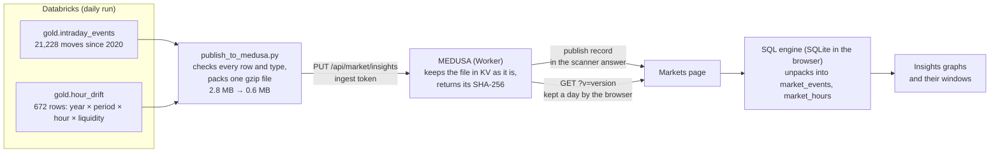

# Step 32: Insights, graphs that look for an edge

[← Lakehouse home](../../README.md) · [← Step 31](31-ops-log-tables.md)

| | |
|---|---|
| **Built** | 32.1: 2026-10-26 to 30 · 32.2.1: 2026-11-01 · the rest of 32.2 and 32.3: next |
| **Commits** | 32.1: `26a06bb` (the graph engine, the Insights view and these docs) · the live results |
| **Files** | [`dbt/models/gold/hour_drift.sql`](../../dbt/models/gold/hour_drift.sql) (the market by hour, every year) and its test · [`serving/publish_to_medusa.py`](../../serving/publish_to_medusa.py) (the Insights file) · [`sql/seed/003_metric_definitions_insights.sql`](../../sql/seed/003_metric_definitions_insights.sql) (version 1 of the 16 definitions) · `databricks.yml` (the seed task) · MEDUSA: [`public/markets-charts.js`](../../../public/markets-charts.js) (the graphs), `public/markets.js`, `public/markets-metrics.js`, `public/markets-sql.js`, `public/markets-window.js`, `src/market.js`, `src/metrics.js`, `src/worker.js` |
| **Decisions** | [ADR-034](../decisions.md#adr-034-the-insights-history-goes-to-medusa-as-one-gzip-file-kept-as-it-is) · [ADR-035](../decisions.md#adr-035-a-graph-is-a-definition-sql-plus-a-chart-spec-drawn-as-svg-by-the-page) · [ADR-037](../decisions.md#adr-037-market-type-comes-from-a-reference-list-and-only-tested-markets-get-a-verdict) |

## Goal

The owner's note: graphs and diagrams that help find an edge (not price charts), made from SQL, that
change when the values do, whose SQL can be edited, and that can be drilled into, each drill opening a
page of its own. Then more graphs and tables, and on-chain data as part of the Markets module, from as
many free sources as there are.

Three parts:

| Part | What | State |
|---|---|---|
| **32.1** | The graph engine and the first seven graphs: the moves since 2020 published to MEDUSA, a graph type in the definitions, drawn by the page, drillable into windows | Done |
| **32.2** | More graphs and tables from data already in the lakehouse: a playbook per live unusual market, crowded or alone, positioning (open interest, long/short, aggressive buying), regime gauges, a risk table | Next |
| **32.3** | On-chain: stablecoins, chain activity, exchange flows, valuation and fees from the free sources, into the lakehouse with the same held-back test | After 32.2 |

## Concepts

| Concept | Here | In SQL Server terms |
|---|---|---|
| **A graph is a query plus a chart spec** | A definition (step 27) whose display has a `chart`: which columns go on which axis, how they are coloured, what a click opens. The SQL decides *what*, the spec decides *how it looks* | An SSRS chart: a dataset query plus the chart's properties |
| **Drill-down** | A click on a bar, cell or point opens a window that runs other definitions with what was clicked (a year, an hour, a size band) as parameters. The window can be drilled into again | An SSRS drill-through report with parameters |
| **NULL means "no filter"** | `WHERE (:year IS NULL OR year = :year)`: one query serves every combination of picks | Optional stored-procedure parameters, `@Year IS NULL OR Year = @Year` |
| **Median, not only average** | `MEDIAN()` (both in the browser's SQLite and in Databricks): the middle move, which a few huge moves can't drag | `PERCENTILE_CONT(0.5) WITHIN GROUP` |
| **Additive sums** | `gold.hour_drift` keeps `days`, `sum_return` and `sum_sq_return`, so any group of rows pools exactly: mean = sum ÷ days, variance from the sum of squares | Storing SUM and COUNT in an aggregate table instead of AVG, so it can be rolled up again |
| **Serving a snapshot file** | The history goes to MEDUSA as one gzip file, kept as it is in KV and unpacked by the browser (ADR-034) | Exporting a table to a file for a client instead of opening a connection to it |
| **Result caching** | A query that reads no live table is run once and kept until its SQL or the data changes, instead of every second | A report snapshot, refreshed when its data changes |

## The graphs

| Graph | The question | How to use it |
|---|---|---|
| **Every market right now** (live) | What is unusual now, and is volume behind it? | Today's move in σ against volume versus a usual day, for every market, once a second. Blue: unusual and its kind of move has a pattern that held up; orange: unusual with no tested edge. A click opens the market |
| **Every kind of move at a glance** | Which kinds of move have a tested edge? | Each kind of move by horizon, coloured by what it did next (each column on its own scale, grey where there are too few days), with its verdict. A click opens its moves |
| **Year by year** | Is a pattern there every year, or in one lucky year? | Median and average next move per year. Up moves turned back every year, median −0.55% to −1.09% over 4 hours |
| **Spread of outcomes** | If I fade, how often do I get hurt badly? | Moves per 1% step. 6.5% of up moves ran another 10% or more within 4 hours: the tail a fade has to survive |
| **By the hour of the move** | Does the time of day matter? | Median by UTC hour: moves starting 01 to 13 UTC turned back about 1 to 2%, those at 19 to 22 UTC hardly at all (−0.05 to −0.13%). An idea to test, not a pattern yet |
| **By size and liquidity** | Do big and small markets behave differently? | Median by size band and liquidity: 6σ moves on small markets turned back most (−4.3%), where trading costs are also highest |
| **The market by hour of the day** | Do some hours lean up or down, and does it last? | 2020–2024 against 2025 on, in basis points. 05, 06 and 21 UTC rose in 2020–2024 (t 2.3 to 3.1); none of them kept it from 2025 |

Each opens windows of its own:

| Window | Opened by | What it shows |
|---|---|---|
| **The moves picked** (`moves`) | A bar, cell or row of the moves graphs | The middle move, the spread of outcomes, year by year (unless one year was picked), and the newest moves; a row opens every past move of that market |
| **The market at an hour** (`drift`) | An hour of the market-by-hour graph | That hour year by year, and by liquidity in 2020–2024 against 2025 on |

Every graph and window has a **‹›** button like Today's numbers: the query as it runs, its version,
Preview, Save, History and the copy for Databricks (the Insights tables have no D1 copy).

## How the history reaches the page

- **Built in 32.1:** `gold.hour_drift`, a new model. The existing `hour_profile` answers the same
  question per coin but only from the minute candles (since September 2026); this reads the whole hourly
  series since 2020. Judged by days, like the evidence: the market's move in each hour of each day (every
  trading coin's return, each counted once and clipped to ±10%), then statistics over days.
- **The file.** The publish job reads both tables, checks every column's type and that no key repeats,
  writes them as JSON with rows as lists, packs it with gzip and sends it. MEDUSA doesn't open it (that
  would take more CPU time than the free plan gives), stores it in KV with its day and row counts, records
  the publish, and reports the file's SHA-256: the job fails unless it matches. The scanner answer carries
  the publish record, so a page asks for exactly that version and the browser keeps it a day.
- **The page.** The file is fetched only when Insights (or a graph's window) is opened. The SQL engine
  unpacks it in its own thread into two tables with the lakehouse's column names, so a query runs in
  Databricks as it is.

## Built in part 32.1

- **The model and its test.** `hour_drift.sql`, documented in `_gold.yml` (tests on period and liquidity)
  and `assert_hour_drift_valid.sql` (one row per key, hours 0 to 23, no group with more days than *all*).
- **The publish job.** `build_insights()` and `send_insights()`; `--insights-file` only builds the file
  (to look at it, or to load it into a local MEDUSA).
- **MEDUSA's server.** `PUT /api/market/insights` (the ingest token; refuses a body that isn't gzip, a
  wrong day or wrong row counts) and `GET /api/market/insights` (signed in only; `?v=` must match for
  the browser to keep it).
- **The definitions.** Three shared steps (`moves`, `moves_picked`, `hour_stats`), seven graphs and six
  window parts, in `markets-metrics.js` and as version 1 in `market.semantic.metric_definitions`
  (`003_metric_definitions_insights.sql`). Seven new parameters: `:direction` and `:horizon` (the choices
  at the top), `:year`, `:hour`, `:bucket`, `:z_band`, `:liquidity` (what a click picked; `:symbol`
  already existed). The page, MEDUSA's save check and the editor accept them.
- **The graphs.** `markets-charts.js` draws a result as SVG: bars (one or more series, or coloured by
  sign), lines, a scatter (with a log axis) and a heatmap (with its colour scale per column if asked).
  Hover or keyboard focus shows a mark's details; every graph can be read as a table under it.
- **The page.** An Insights view with Up/Down moves and Next 1/4/24 h; windows for each graph and for
  the drills; a result that reads no live table is kept instead of run every second (the Insights
  graphs read 21,000 rows: the engine runs only the live graph each second).

## Result

| Check | Result |
|---|---|
| `hour_drift` | Run read-only on the whole history before it was a model: 2,469 days, 672 rows. In 2020–2024 hours 05 (+6.5 bp, t 3.1), 06 (+5.3 bp, t 2.6) and 21 (+5.5 bp, t 2.3) rose; from 2025 none kept it (−0.1, −3.7 and +2.2 bp, t between −1.3 and 0.7) |
| The file | 21,228 moves and 672 hour rows, 2.77 MB of JSON, 0.58 MB packed; every type checked |
| MEDUSA, locally | Refused without a token, with a wrong one, with a body that isn't gzip, a bad day or bad row counts; the file stored byte for byte (same SHA-256); signed-out readers refused; `?v=` current kept a day, otherwise not kept; the scanner answer carries both publish records |
| The graphs | Every query run on the real file in the browser's SQLite (8 to 130 ms) and, copied, in Databricks: the same results (one move of 13,576 lands in the next 1% step, from the file's rounding) |
| The page | All seven graphs drawn; the live map with 669 markets; drills by year, hour, size and liquidity, outcome step and market; the toggles redraw a window; an edited graph previewed next to the current one; no horizontal scrolling at phone width; no console errors |
| Seed | Planned with `EXPLAIN` in Databricks; no `;` in any text (the statement splitter) |
| Live, the definitions | 33 current definitions in `market.semantic.metric_definitions` (17 before, 16 added; 7 of them shared steps), versions without gaps, every display valid JSON |
| Live, the first run | **Lakehouse transform** run 7, started by hand, 4 min 11 s: `hour_drift` built (672 rows, 2020-01-21 to 2026-10-27), 16 models and snapshots, 139 tests passed (131 before, 8 new), no warnings or errors; published `market_baseline` 753, `market_evidence` 60, `market_metrics` 33, `market_events` 21,306, `market_hours` 672, every row reconciled |
| Live, the schedule | The next daily load (30 October, loading the 29th) republished everything on its own at 18:51 UTC, the Insights file with it (lakehouse day 2026-10-29) |

## Problems we hit

- **SQL that runs in two places.** The graphs run in the browser's SQLite and are copied to Databricks.
  `MEDIAN`, `CONCAT`, `FLOOR` and `SQRT` exist in both; percentiles don't (`percentile_cont` in neither
  the same way), `EXISTS` inside a `CASE` may not run in Databricks (the live map uses a join instead),
  and `FLOOR` returns a decimal in SQLite, so the 1% step is cast to an integer before it becomes a label.
- **A heatmap washed out.** One colour scale for the next hour (moves of about 0.2%) and the next 24
  hours (up to 20%) left the hour column grey. The scale now stops at the 90th percentile of sizes and,
  for the patterns map, is set per column.
- **The loudest cells were the weakest.** The groups with too few days had the most extreme averages and
  drew the eye. They are grey now.
- **Running 21,000 rows every second.** The engine reran every query each second. A result that reads no
  live table is now kept until its SQL or the data changes.
- **A test that never ended.** Importing the page's code in Node kept the process alive (its channel to
  other tabs); the local tests end with `process.exit`.

- **Binance skipped a day while this was deployed.** Its archive has no candles for 28 October (see
  below), which stopped the daily runs of 29 October. The Insights work didn't depend on it: a transform
  by hand rebuilt everything from the data already loaded.

## A hole in the history: 28 October

Binance's daily archive has no 1-minute candles (nor 1-day, mark or index candles, nor aggregated trades)
for 2026-10-28, for any coin; its metrics and raw trades for that day are there, and the days either side
were published on time. The candles exist: Binance's live API returns all 1,440 for Bitcoin. Until it is
filled:

- The daily runs of 29 October stopped at the download check (*NOT READY klines_1m 2026-10-28*), as
  designed (ADR-021), and the next day's run loaded the 29th.
- Gold has no row for the 28th. The 29th has no daily return, because the day before is missing, so
  `market_daily` shows no breadth for it, `data_health` counts all 887 coins as new, and
  `intraday_events` has no moves on the 28th or 29th.
- **Nothing on the page shows this.** The status line gives the newest day, and the 139 dbt tests check
  the rows that exist, not the days that don't. The recheck only re-checks days already loaded, so
  nothing fills the day by itself. [Step 32a](32a-missing-days.md) fixes all three: a missing-days check,
  a warning on Markets and a catch-up in the daily load.

## 32.2.1: what kind of market each move is

Binance's stock and commodity perpetuals began in December 2025. Until now they were mixed into every
move, and the verdicts on the page, chosen on 2020 to 2024, were shown on them too. So the first part of
32.2 puts the market's type on each move, splits the graphs by it, and stops showing a verdict that was
never tested on that kind of market.

**What the numbers said** (Databricks, 2026-10-31, using Binance's own labels):

| Moves over the next 4 hours, from December 2025 | Moves | Median | Ended higher |
|---|---:|---:|---:|
| Crypto, up | 5,146 | −0.87% | 41% |
| Crypto, down | 1,823 | +0.43% | 55% |
| Stocks, up | 340 | +0.04% | 51% |
| Stocks, down | 264 | +0.01% | 50% |

Crypto's unusual moves tend to turn back. On stocks so far it is a coin toss, so a *fade* verdict on a
stock was claiming something the data doesn't show.

| Concept | Here | In SQL Server terms |
|---|---|---|
| **Reference data** | A short list that describes other data and rarely changes: `dim_market_type`, one row per symbol | A lookup table |
| **dbt seed** | A CSV file in the repository that `dbt build` loads as a table. Changes are reviewed and versioned like code | A lookup table filled by a script kept in source control |
| **A key can change meaning** | `MDTUSDT` was a crypto token until 2024 and has been Medtronic since 2026. The type therefore depends on the date of the move, not only the symbol | A business key reused for a new entity, handled with effective dates |
| **Same population for the claim and the test** | A verdict can only describe the markets it was tested on. Stocks have no 2020 to 2024 years, so they can't be tested by this rule at all | A report that filters to the rows its definition covers |

**What was built:**

- **`silver.dim_market_type`,** a dbt seed of 924 markets: 683 crypto, 221 stock, 12 other (indices, a currency,
  pre-IPO markets) and 8 commodity. Binance's archive doesn't say what a market is, only its live contract list
  does, and that API can't be relied on from GitHub's servers. So
  [`ingest/refresh_market_types.py`](../../ingest/refresh_market_types.py) is run on a person's computer and the
  file is committed. A market Binance has delisted stays in the file, and the 31 that had already gone were added
  by hand from the lakehouse's own history.
- **`market_type` on `gold.intraday_events`.** A stock or commodity contract's moves before its listing day are
  crypto, which is how the 19 moves of the old MDT token stay crypto. A market not in the list is `unknown`.
- **A warning, `assert_market_types_known`,** when a trading market isn't in the list yet. Until the list is
  refreshed, its moves stay out of the evidence and it shows as *not tested*: the safe side.
- **`event_evidence` keeps crypto and other markets only.** Stocks and commodities have no moves in the in-sample
  years, so leaving them out changes nothing that chose a side.
- **The page.** `flagged` gains `tested`. A stock or commodity shows *not tested* in place of a verdict, and isn't
  counted as being in a pattern. Seven definitions moved to version 2, the first new versions made by a seed:
  [`004_metric_definitions_market_type.sql`](../../sql/seed/004_metric_definitions_market_type.sql) closes
  version 1 and adds version 2 in one `MERGE`, the way a save on the page does.

**Result before the live run:**

| Check | Result |
|---|---:|
| Verdicts changed, of 60 | 0 |
| Sides changed | 0 |
| In-sample numbers changed | 0 |
| Moves in the evidence | 20,721 of 21,373 (606 stock and 46 commodity moves left out) |

The 5 patterns that held up all still hold, and their results from 2025 improve slightly, for example down 4–6σ on
mid-sized markets over 1 hour from +3.96% to +4.71%. The same comparison also confirmed why `other` stays in:
removing the index markets too shifted 2020 to 2024 and flipped borderline verdicts, which is exactly what this
change must not do.

The page was tested locally with the real 21,373 moves: with *Stocks* chosen, *Year by year* draws 340 up moves,
median +0.04%, average +0.37%, 51% kept going, the same as Databricks. There was no real unusual stock at the time
of the test, so Apple and gold were made unusual on the local copy only: both show *not tested* with no verdict,
while crypto rows keep theirs.

**Limits:**

- The list has to be refreshed by hand. New stock perpetuals only reach a z after 20 days of history, and the
  warning says when one is missing.
- Stocks can't be tested by this rule until enough years pass. A test of their own, on their own short history,
  is a separate question for later.

### The filter everywhere, and a publish that arrives

After the first version went live, the owner chose Stocks and nothing changed: 2020 still showed 227 moves. Two
separate things were wrong.

**The page was holding the old definitions.** Everything live was right: `moves` version 2 and the Insights file
with its 606 stock moves were both there from 23:16 UTC. But a browser kept the daily answer for 5 minutes, and an
open page only asked again every 30, so a page opened before the publish went on running version 1, showing a filter
that did nothing. Now a browser keeps the answer for 1 minute, and an open page asks every 5 minutes, loading only
if the publish records changed, so kept results aren't thrown away for nothing. An open page was left running during
the test: it picked up the new definitions by itself at the 5-minute mark, with no reload.

**Some numbers never had the filter.** They read tables with no market type:

| Graph or table | What changed |
|---|---|
| The market by hour of the day, and its window's two tables | `gold.hour_drift` gains `market_type`, each with an `all` row. `hour_stats` and `drift_by_year` read `market_type = :kind` |
| Every kind of move at a glance | Built from the moves of the type chosen instead of from `market_evidence`, which has no type. Its verdicts still come from the evidence; stocks and commodities show *not tested* |
| Patterns: *Right now* and *Now* | Count markets of the type chosen. For stocks and commodities the view says they aren't tested |

The filter now shows on all three views. **Only the Bitcoin card ignores it, on purpose:** it is the reference
point whatever type is chosen.

| Check | Result |
|---|---:|
| `hour_drift`'s `all` rows against the table as it stands | 672 of 672 the same, 0 differ |
| Rows after the change | 2,088: 672 all, 672 crypto, 504 other, 144 commodity, 96 stock |
| The seven graphs of Insights, for each of the 5 types, locally with real data | All change with the type, none fails |
| Stocks, hour 0, against Databricks | +4.1 bp, t 1.6, the same |
| Insights file | 0.67 MB, from 0.60 |
| A filter click to the screen on Today, 8 tries | 0.1 to 0.3 seconds for 6, 0.75 for one, and one of 5.9 that wasn't explained or seen again, in a test browser running unfocused |

## Next: 32.2 and 32.3

- **Before them:** [step 32a](32a-missing-days.md), the missing-days check, and filling 28 October
  (October's monthly 1-minute file, expected around 2 November, if it holds that day; otherwise the live
  API).
- **The rest of 32.2, from data already here:** a playbook table per live unusual market (similar past moves, median
  next 1/4/24 h, how often it kept going, the worst 5%), crowded or alone (a move on a day many markets
  moved against one on its own), positioning from `fct_metrics_5m` (open interest against price, the
  long/short ratio, aggressive-buy share), regime gauges and a risk table.
- **32.3, on-chain from the free sources:** DefiLlama (stablecoins, chain TVL, DEX volume, fees),
  CoinMetrics Community (exchange flows, active addresses, MVRV, transactions), mempool.space (Bitcoin
  fees), and the other free APIs surveyed first, loaded by GitHub Actions into landing → bronze → silver
  → gold and tested held-back like the patterns.
